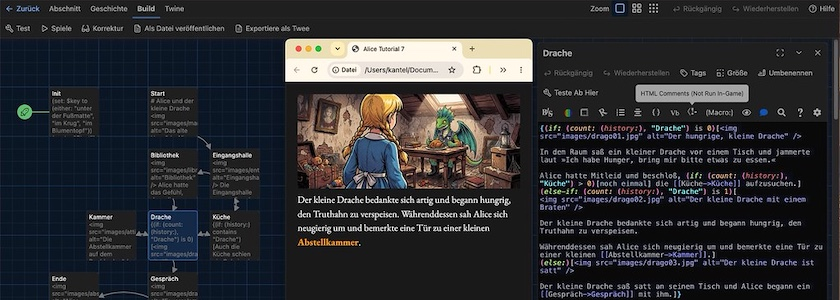
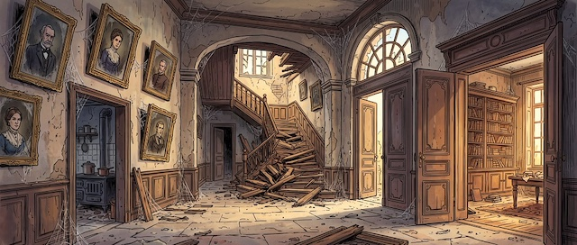
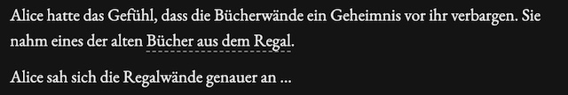
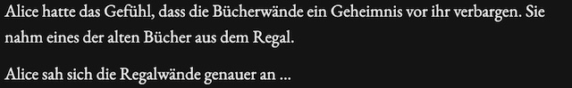
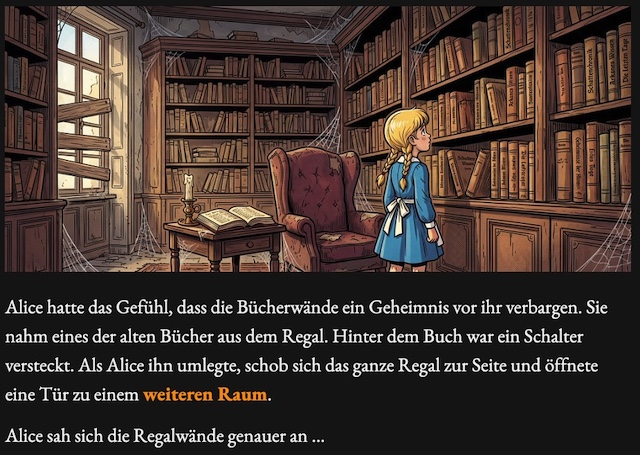
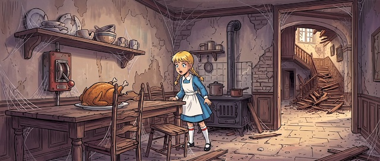
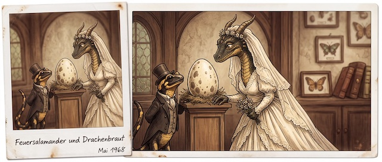

In der letzten Woche war es zwar ruhig hier auf diesen Seiten, aber ich habe nicht auf der faulen Haut gelegen. Sondern ich habe mich weiter durch die [aktuelle Dokumentation](https://twine2.neocities.org/) des [Twine](http://cognitiones.kantel-chaos-team.de/multimedia/spieleprogrammierung/twine2.html)-Storyformats Harlowe gewühlt, um ein weiteres Tutorial für die kleine, freie Engine für interaktive Geschichten (und vielem mehr) zu schreiben. Auch heute geht es in der Hauptsache um (neue) **Makros** und **Hooks**, den kleinen »Haken«, die an den Makros hängen.

Dafür habe ich Alice [noch einmal](https://kantel.github.io/posts/2026091001_alice_tutorial_5/) in die Bibliothek geschickt, um dort ein weiteres Abenteuer zu erleben. Doch der Reihe nach:

Auch dieses Mal beginnt die Geschichte mit der Startpassage `Init`, die außer einer (zufallsgesteuerten) Variablendeklaration die Leserin oder den Leser sofort auf die Passage `Start` weiterleitet:

~~~text
(set: $key to (either: "unter der Fußmatte", "im Krug", "im Blumentopf"))

(go-to: "Start")
~~~

Das Makro `either:` setzt die Variable `$key` zufällig auf einen der drei Werte `unter der Fußmatte`, `im Krug` oder `im Blumentopf`. Damit spiele ich auf das Vorgängertutorial an, in dem der Schlüssel ebenfalls zufällig an einem dieser drei Orte versteckt war.

Die eigentlich Geschichte beginnt in der Passage `Start`, auf die `Init` mit dem Makro `go-to:` automatisch weiterleitet.

~~~text
# Alice und der kleine Drache

Alice war im Wunderland wieder zum alten Haus mit der Bibliothek unterwegs. Da sie 
wusste, dass der Türschlüssel $key versteckt war, hatte sie keine Schwierigkeiten, in 
das Haus zu kommen.

Sie schloß die [[Tür zur Eingangshalle->Eingangshalle]] auf.
~~~

Hiermit ist die Reminiszens auf den vorherigen Bibliotheksbesuch aber auch schon abgehakt und Alice betritt die Eingangshalle[^1]:

[^1]: Auch die Bilder für dieses Tutorial habe ich von einer gekünstelten Intelligenzia meines Vertrauens ([OpenArt](https://openart.ai/home)) generieren lassen. Mit einem Klick auf die Bilder kommt Ihr auf eine Seite, die Euch verrät, welchen Prompt und welches Modell (in diesm Fall Nano Banana&nbsp;2 für alle Bilder) ich gewählt habe.

~~~text

Die Eingangshalle war groß und leer. Im Hintergrund gab es eine große, 
repräsentative, aber verfallene Treppe, die auf Alice keinen sicheren Eindruck 
machte und die sie lieber nicht betreten wollte.

Links durch eine offene Tür konnnte sie eine [[Küche->Küche]] erkennen 
und rechts von ihr war der Eingang zur 
[[alten Bibliothek->Bibliothek]].
~~~

Diese Passage besitzt keine neuen Elemente, also wenden wir uns der `Bibliothek` zu (die `Küche` wird später noch einmal besucht und dann in diesem Tutorial behandelt):

~~~text

Alice hatte das Gefühl, dass die Bücherwände ein Geheimnis vor ihr verbargen. 
Sie nahm eines der alten |regal>[Bücher aus dem Regal]. {
(click:?regal, 
(action: "mouseover"))[Hinter dem Buch war ein Schalter versteckt. Als Alice ihn 
umlegte, schob sich das ganze Regal zur Seite und öffnete eine Tür zu einem 
[[weiteren Raum->Drache]].]}

Alice sah sich die Regalwände genauer an …
~~~

Hier passiert ganz viel Neues: Erst einmal wird, statt eines anonymen Hooks, der einfach an das Makro angehängt wird, ein [**benannter**](https://twine2.neocities.org/#markup_named-hook) *(named)* Hook verwendet. Der Name eines Hooks kann entweder mit `|name>[zu markierende Textpassage]` **vor** dem betreffenden Text, oder mit `[zu markierende Textpassage]<name|` **nach** dem betreffenden Textteil gesetzt werden. In diesem Fall ist der Name des Hooks `regal` und er wurde **vor** dem betreffenden Text `[Bücher aus dem Regal]`[^2] gesetzt.

[^2]: Beachtet, daß auch benannte Hooks mit einfachen, eckigen Klammern (`[Hook]`) markiert werden müssen.

Benannte Hooks können dann mit ihrem Namen in der Passage (üblicherweies, aber nicht zwingend am Ende der Passage[^3]) aufgelöst werden. Namen werden wie Variablen behandelt, nur dass statt des Dollarsymbols (`$`) ein Fragezeichen (`?`) vorangestellt wird. In diesem Fall wird das[ Makro `click:`](https://twine2.neocities.org/#macro_click) in Kombination mit dem [`action:`-Makro](https://twine2.neocities.org/#macro_action) aufgerufen[^4]: 

[^3]: Den letzten, ziemich sinnfreien Satz in der obigen Passage habe ich nur angefügt, um zu zeigen, dass die Auflösung **nicht** am Ende der Passage stattfinden muss.

[^4]: Harlowe besitzt für solche Fälle eigentlich noch ein [`mouseover:`-Makro](https://twine2.neocities.org/#macro_mouseover), aber das gilt als veraltet und sollte nicht mehr verwendet werden, da es aller Voraussicht nach in Harlowe&nbsp;4.0 gestrichen wird.

~~~text
(click:?regal, (action: "mouseover"))[Hinter dem Buch war ein Schalter 
versteckt. Als Alice ihn umlegte, schob sich das ganze Regal zur Seite und 
öffnete eine Tür zu einem [[weiteren Raum->Drache]].]
~~~

`mouseover`-Links werden in Harlowe bei Default mit einem gestrichelten Unterstrich gekennzeichnet:

Das war aber nicht das, was ich wollte. Die Spielerin oder der Spieler sollten schon ein wenig suchen, bis sie einen Ausweg aus der Bibliothek finden. Daher habe ich per CSS die Markierung ausgeschaltet:

~~~css
tw-link.enchantment-mouseover, .link.enchantment-mouseover, 
tw-expression.enchantment-mouseover > tw-link {
  border-bottom: none;
}
~~~

Dann sieht die Passage nach dem Aufruf so aus:

In beiden Fällen bewirkt aber das Überfahren von »Bücher aus dem Regal«, das ein Stück Text wie von Zauberhand geschrieben, in die Passage hineingemogelt wird:

Wenn Ihr Eure Leserinnen und Leser aber nicht vor den Kopf stoßen wollt, solltet Ihr den Trick mit den unsichtbaren Links nur mit Bedacht verwenden. In diesem Fall war es noch recht einfach, da es keinen offensichtlichen Ausgang aus der Passage gab, musste er irgendwo versteckt sein. Also streicht die Nutzerin oder der Nutzer mit der Maus über die Passage (Bild ([Imagemaps](https://kantel.github.io/posts/2026081102_imagemaps_twine/)!) **und** Text), in der Hoffnung, irgendwo einen versteckten Ausweg zu finden. Das macht ja geradezu den Reiz einer solchen interaktiven Geschichte aus.

Wurde dann der Ausgang aus der Bibliothek gefunden, trifft Alice auf den kleinen Drachen *Drago* (Passage: `Drache`):

~~~text
{(if: (count: (history:), "Drache") is 0)[

In dem Raum saß ein kleiner Drache vor einem Tisch und jammerte laut 
»Ich habe Hunger, bring mir bitte etwas zu essen.«

Alice hatte Mitleid und beschloß, (if: (count: (history:), "Küche") > 0)
[noch einmal] die [[Küche->Küche]] aufzusuchen.]
(else-if: (count: (history:), "Drache") is 1)
[

Der kleine Drache bedankte sich artig und begann hungrig, den Truthahn 
zu verspeisen.

Währenddessen sah Alice sich neugierig um und bemerkte eine Tür zu einer 
kleinen [[Abstellkammer->Kammer]].]
(else:)[

Der kleine Drache saß satt an seinem Tisch und Alice begann ein [[Gespräch->Gespräch]] 
mit ihm.]}
~~~

Alice kann die Passage mehrmals aufsuchen, und jedes Mal ändert sich der Zustand des Drachens (von »hungrig« zu »speisend« zu »satt«). Dies kann man mit einer ziemlich gewagt aussehenden Kombination aus `if:`, `else-if:` und `else:` in Verbindung mit `count:` und `history:` abbilden. Die Makros [`if:`](https://twine2.neocities.org/#macro_if), [`else-if:`](https://twine2.neocities.org/#macro_else-if) und [`else:`](https://twine2.neocities.org/#macro_else) hatte ich [im letzten Tutorial](https://kantel.github.io/posts/2026100601_alice_tutorial_6/) schon abgehandelt, neu sind die `count:`- und `history:`-Makros:

Das [`count:`-Makro](https://twine2.neocities.org/#macro_count) zählt die Anzahl der Elemente eines Strings oder eines Array[^5]. In Verbindung mit dem [`history:`-Makro](https://twine2.neocities.org/#macro_history), das ein Array aller bisher besuchten Passagen (in diesem Fall mit dem Namen »Drache«) zurückgibt, erfährt Twine, wie oft diese Passage besucht wurde. 

[^5]: Über Arrays erzähle ich in einem späteren Tutorial mehr.

Da der aktuelle Besuch (noch) nicht mitgezählt wird, bedeutet $0$, dass die Passage zum ersten Mal besucht wurde, $1$ gibt es beim zweiten Besuch der Passage und so weiter.

Die Passage `Drache`  zeigt übrigens auch sehr schön, dass jedes `if:`, `else-if:` oder `else:` auch eigene Bilder mitbringen kann.

Da Alice beim zweiten Besuch (wieder?) in die `Küche` geschickt wird, möchte ich diese Passage als nächstes abhandeln:

~~~text
{(if: (history:) contains "Drache")[Auch die Küche schien ein Geheimnis 
zu verbergen. Vor Alice stand ein großer, leerer Tisch. An der Wand links neben 
ihr hing ein weiterer, großer (link: "Schalter. ")[Schalter.

Als Alice ihn umlegte, lag auf dem Tisch wie von Zauberhand ein Teller mit 
einem gebratenen Truthahn. Alice nahm den Teller mit dem Braten und brachte ihn 
zu dem kleinen [[Drachen->Drache]].] ]
(else:)[

Die Küche machte auf Alice einen schmuddeligen, aber leeren Eindruck. Sie ging 
daher lieber wieder [[zurück in die Eingangshalle->Eingangshalle]].]}
~~~

Auch hier kommt das Makro `history:` zum Einsatz, allerdings wird hier gefragt, ob das `history`-Array die Passage `Drache` enthält (`(if: (history:) contains "Drache")`). Wenn dies der Fall ist, kommt der erste Teil zum Einsatz, in dem Alice einen Schalter umlegt und so einen Braten auf den Tisch zaubert.

In allen anderen Fällen (es gibt in diesem Fall nur einen) kehrt Alice unverrichteter Ding in die Eingangshalle zurück.

Hat Alice dem Drachen den Truthahnbraten gebracht, entdeckt sie eine `Kammer`, die sie aufsucht:

~~~text

Die Abstellkammer war leer und so ging Alice, nachdem sie eine Weile das dort 
liegende Spielzeug inspiziert hatte, wieder zurück in den 
[[Raum mit dem kleinen Drachen->Drache]].
~~~

In dieser Passage passiert wieder nichts Neues, der Zweck ihres Daseins ist nur, dass Alice die Passage `Drache` zum dritten Mal aufsuchen kann.

Nach dieser Passage kommt Alice mit dem Drachen in ein `Gespräch`:

~~~text

Der kleine Drache erzählte stolz, dass er Drago heiße und der Sohn eines 
Feuersalamanders sei, der sich in eine Drachenfrau verliebt hätte. Sie habe 
seine Liebe erwidert und dann ein Ei gelegt, aus dem der kleine Drago geschlüpft sei.

Er sei etwas kleiner, als die anderen Drachen und er könne auch kein Feuer 
spucken, aber ansonsten fühle er sich wie die großen Drachen.

[[Weiter …->Ende]]
~~~

Hier erfährt Alice zwar einiges über *Dragos* Herkunft, aber technisch ist die Passage eigentlich langweilig -- es gibt wieder nichts Neues. Aber irgendwann muss die Geschichte ja auch einmal zu einem `Ende` kommen:

~~~text

Alice hörte ihm geduldig zu und bedankte sich für seine Gesellschaft.

Als sie wieder nach Hause ging, hatte sie das Gefühl, einen neuen Freund 
gewonnen zu haben.

Damit ist die heutige Geschichte zu Ende. 
(link: "Noch einmal Spielen?")[(restart:)]
~~~

Hier habt Ihr die Möglichkeit, die ganze Geschichte noch einmal zu spielen. Das `restart:`-Makro setzt alles auf Null, das heißt auch das `history`-Array wird wieder geleert.

### Das Spiel

Wie (fast) immer habt Ihr hier die Möglichkeit, die Geschichte von Alice und dem kleine Drachen, eingebettet in diese Seiten, zu spielen:

<iframe width="100%" height="600" src="alice7/"></iframe>

Auch dieses Tutorial habe ich sowohl als HTML-Datei wie auch als Twee-Datei mit allen Assets (Bilder und Schriften) auf meinem [GitHub-Account hochgeladen](https://github.com/kantel/twine-entdecken/tree/master/Twine/alicereloadedharlowe/alice7). Habt Spaß damit!

Und natürlich habe ich dieses Spielchen – wie die anderen auch – auf meiner [Neocities-Spielwiese veröffentlicht](https://kantel.neocities.org/twine/alice7/). Denn dafür ist meine Spielwiese schließlich da.&nbsp;🤓

## Was bisher geschah

Meine Twine-Harlowe-Reihe besteht bisher aus diesen zehn Beiträgen (das ist schon ein kleines Jubiläum&nbsp;🎊🎉):

1. Der Wunderland-Debattierclub: [Klickbare Imagemaps in Twine](https://kantel.github.io/posts/2026081102_imagemaps_twine/)
2. [Zurück ins Wunderland (schon wieder)](https://kantel.github.io/posts/2026082001_zurueck_ins_wunderland/) und dieses Mal mit Harlowe
3. Alles auf Anfang: [Mit Twine und Harlowe ins Wunderland](https://kantel.github.io/posts/2026082301_twine_harlowe_wunderland/)
4. Aus meiner Webwerkstatt: [Twine-Stories in die eigenen Seiten einbinden](https://kantel.github.io/posts/2026082401_twine_einbinden/)
5. [Alice und die Teeparty](https://kantel.github.io/posts/2026082601_alice_teeparty/): Mit Twine und Harlowe ins Wunderland (Teil 2)
6. [Alice und Humpel Pumpel](https://kantel.github.io/posts/2026090102_alice_und_humpelpumpel/): Mit Twine und Harlowe ins Wunderland (Teil 3)
7. [Qumbo schreibt (schön)](https://kantel.github.io/posts/2026090701_custom_fonts_harlowe/): Custom Fonts in Twine (Harlowe)
8. [Mit Alice in die Bibliothek](https://kantel.github.io/posts/2026091001_alice_tutorial_5/): Variablen, Makros und Hooks in Twine (Harlowe)
9. [Mit Alice in das Reich der Ringe](https://kantel.github.io/posts/2026100601_alice_tutorial_6/): Noch mehr zu Variablen, Makros und Hooks in Twine (Harlowe)
10. Alice und der kleine Drache: Noch mehr über Makros und Hooks in Twine (Harlowe)

Fortsetzung folgt …

