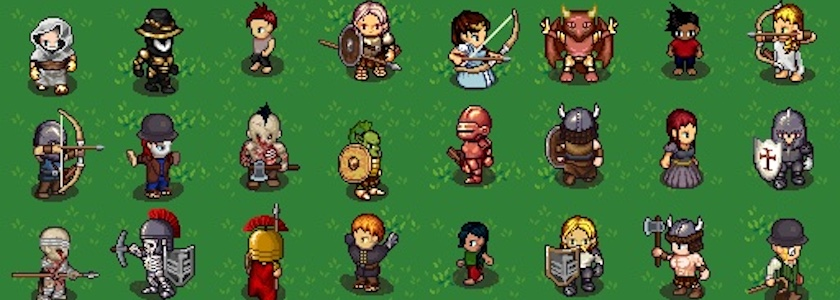

Via *Franks Laboratory* auf YouTube kam mir der [Universal LPC Spritesheet Generator](https://liberatedpixelcup.github.io/Universal-LPC-Spritesheet-Character-Generator/) unter. Das ist ein freier (GPL) Pixel-Generator ([Quellcode auf GitHub](https://github.com/liberatedpixelcup/Universal-LPC-Spritesheet-Character-Generator)) für $32$x$32$ Pixel große Spielefiguren, der ursprünglich für den [Liberated Pixel Cup](https://lpc.opengameart.org/) (LPC) entwickelt wurde. Das LPC ist ein Gemeinschaftsprojekt zahlreicher Pixel-Künstler, die Sprites dafür erstellt haben.

<iframe class="if16_9" src="https://www.youtube.com/embed/U-i-SglFpKg?si=OS6Ko9CTbaPH138o" title="YouTube video player" frameborder="0" allow="accelerometer; autoplay; clipboard-write; encrypted-media; gyroscope; picture-in-picture; web-share" referrerpolicy="strict-origin-when-cross-origin" allowfullscreen></iframe>

Mit diesem kostenlosen, browserbasierten Sprite-Generator könnt Ihr und kann ich tausende vollständig animierte, handgezeichnete Charaktergraphiken erstellen -- ganz ohne Zeichenkenntnisse, Photoshop/Gimp oder den Kauf von Asset-Paketen.

Das Tool kontentriert sich zwar zwar auf Charakter-Sprites, LPC enthält aber auch viele Tilesets und andere Graphiken. Diese Tileset-Sammlungen findet Ihr auf [OpenGameArt.org](https://opengameart.org/lpc-art-entries).

Die Lizensierung ist etwas kompliziert, da die einzelnen Künstler ihre (Teil-) Bilder zwar unter offenen, aber teilweise unterschiedlichen Lizenzen veröffentlicht haben und sie (zu Recht) genannt werden wollen. Jedoch könnt Ihr bei der Verwendung des Generators eine Textdatei im CSV- oder Klartextformat mit herunterladen, die alle Lizenzinformationen der in Eurem Spritesheet ausgewählten Elemente enthält.

**War sonst noch was?** Ach ja, wegen freier Tile- und Spritesets noch dieses: Kenneys $16$x$16$ Pixel große [Tiny-Serie](https://kenney.nl/assets/series:Tiny) hat in diesem Jahr mit der [Tiny Farm](https://kenney.nl/assets/tiny-farm) und der [Tiny Factory](https://kenney.nl/assets/tiny-factory) zwei Erweiterungen spendiert bekommen. Wie alles von Kenney sind auch diese Erweiterungen Public Domain ([CC0](https://creativecommons.org/publicdomain/zero/1.0/)).

<iframe class="if16_9" src="https://www.youtube.com/embed/orvi9o88xyY?si=jT9hlip1f2zo8rBj" title="YouTube video player" frameborder="0" allow="accelerometer; autoplay; clipboard-write; encrypted-media; gyroscope; picture-in-picture; web-share" referrerpolicy="strict-origin-when-cross-origin" allowfullscreen></iframe>

Und auf *Franks Laboratory* findet Ihr auch den [Vanilla JavaScript Game Development Course](https://www.youtube.com/playlist?list=PLYElE_rzEw_tjnJ_5gzRw0ZM5HRn7AIS0). Das ist eine Playlist mit (aktuell!) 17 Videos, die Euch zeigen will, wie Ihr ein Vanilla JavaScript Game Starter Kit von Grund auf mit reinem JavaScript und dem HTML Canvas erstellt. Zwar habe ich mir vorgenommen, in Sachen JavaScript im Allgemeinen und Spieleentwicklung mit JavaScript im Besonderen, mich auf [P5.js](http://cognitiones.kantel-chaos-team.de/programmierung/creativecoding/processing/p5js.html) zu [konzentrieren](https://kantel.github.io/posts/2026101501_q5_webeditor_v2/), aber ich bin mir dennoch sicher, dass ich von dieser Playlist viel lernen kann. *Still digging!*