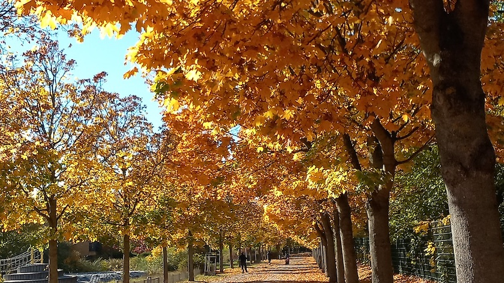

Wie schon in all den Jahren [zuvor](https://kantel.github.io/posts/2025102701_herbst_carl_weder_park/), habe ich auch in diesem Jahr wieder versucht, das herbstlich bunte Laub des [Carl-Weder-Parks](https://de.wikipedia.org/wiki/Carl-Weder-Park) in meiner Nachbarschaft mit der Kamera aufzunehmen. Und das sonnige Oktoberwetter machte es mir heute wirklich einfach. Die eingefangenen Farben zeigen doch deutlich, was ein goldener Oktober ist und wie schön er sein kann.

---

**Photo** ([cc](https://creativecommons.org/licenses/by-sa/4.0/deed.de)) 2026: *[Jörg Kantel](http://cognitiones.kantel-chaos-team.de/cv.html)*