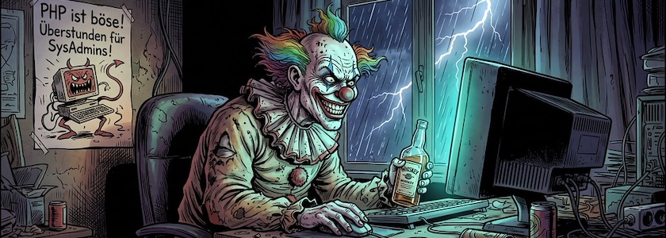

Diese Sicherheitswarnung hat es in sich: So gut wie alle derzeit noch genutzten PHP-Server -- zurück bis zum vor mehr als 20 Jahren veröffentlichten PHP&nbsp;5 -- lassen sich einfach übernehmen. Und auf PHP basiert heutzutage ein Großteil des gesamten Internets, da fast 80&nbsp;Prozent aller Webseiten mit PHP betrieben werden. Daher gingen schon im Vorfeld zahlreiche Webseiten aus Sicherheitsgründen offline. In Berlin und Brandenburg waren das laut [Informationen von RBB24](https://www.rbb24.de/panorama/beitrag/2026/10/it-sicherheitsbehoerde-bsi-kritische-schwachstelle-webanwendunge.html) unter anderem das Robert-Koch-Institut (RKI), die Berliner Tafel, Bündnis 90/Die Grünen, die Universität Potsdam, die [Charité](https://www.rbb24.de/wirtschaft/beitrag/2026/10/charite-berlin-website-down-sicherheit-it-medizin.html) - aber auch die Bundespolizei, der Zoll und das Bundesinnenministerium (BMI).

Und wie der österreichische [Standard berichtete](https://www.derstandard.de/story/3000000345274/warnung-vor-extrem-gefaehrlichen-php-luecken-sorgt-fuer-viel-aufregung-im-web), war schon im [Vorfeld war laut Arstechnica ein Video im Umlauf](https://arstechnica.com/security/2026/10/php-maintainers-tell-web-devs-to-prepare-themselves-for-critical-security-patches/), das zeigte, wie mithilfe der beiden Lücken Server mit viel genutzter Software wie WordPress, MediaWiki, Drupal oder auch phpBB übernommen werden können. Der parallel dazu aufgetauchte Name »PHP2Shell« verweist wiederum auf exakt diesen Umstand -- also das man so einfach unberechtigten Shellzugriff auf Server erhalten kann.

Seit heute um 16:00 Uhr [veröffentlicht das PHP-Projekt](https://www.php.net/archive/2026.php#2026-10-21-5) nun Updates für alle noch unterstützten Versionen der Software als auch Details zu den Sicherheitslücken. Die neuen, fehlerbereinigten Versionen sind 8.5.12, 8.4.27, 8.3.36 und 8.2.35. Für die SysAdmins der betroffenen Server sind nun Überstunden angesagt.

Der **Schockwellenreiter** ist davon nicht betroffen, da er seit Jahren als statische Site betrieben wird und die alte WordPress-Version schon 2012 vom Netz genommen wurde. Auch wenn der Schritt damals viel belächelt wurde, ich bin froh, vor etwa 15 Jahren diese Entscheidung getroffen zu haben.

---

**Bild**: *[PHP2Shell](https://www.flickr.com/photos/schockwellenreiter/55603682674/)*, erstellt mit [Scenario](http://cognitiones.kantel-chaos-team.de/technikgeschichte/rechnerundnetze/scenario.html), Prompt: »*A horror clown sits at a desk in front of a computer, grinning diabolically. He operates the mouse with his right hand, while holding a bottle of whiskey in his left. Through a large window in the background, a stormy night sky—complete with rain, lightning, and thunder—is visible. On the wall hangs a poster that reads: "PHP ist böse! Überstunden für SysAdmins!" Franco-Belgian comic book style. Language: German; no speech bubbles, no text boxes, no headings.*« Modell: Nana Banana&nbsp;2.1.

