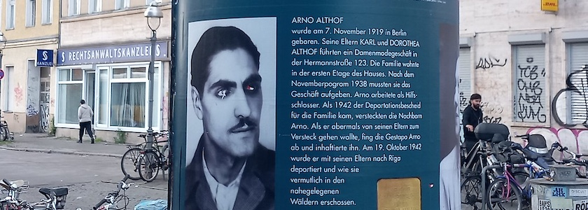

Vor 85 Jahren, am 18. Oktober 1941, fand die erste Deportation von Jüdinnen und Juden aus Berlin statt. Etwa 1.030 Menschen wurden aus einem Sammellager in Moabit quer durch die Stadt zum Bahnhof Grunewald getrieben und dort vom Gleis 17 abtransportiert. Der Theatermacher *Günter Jeschonek* hat aus diesem Anlass 25&nbsp;Litfaßsäulen in ganz Berlin unter dem Motto »**Sie wollten Leben**« aufgestellt, um explizit an 80 Schicksale zu erinnern.

Zwei dieser Stelen stehen noch bis Mitte November in Neukölln. Eine vor dem Rathaus und eine am S-Bahnhof Hermannstraße. Die Abendschau berichtete darüber in der Sendung am 15.10.2026 um 19:30 Uhr. Zwei zwei dieser Biographien wurden von *Karin Kuhrt* recherchiert, Mitglied des Bürgervereins [**proNeubritz e.V.**](https://proneubritz.jimdofree.com/) und für die Recherche etlicher in Neubritz verlegter Stolpersteine verantwortlich. Aus diesem Anlass wird die diesjährige **Stolpersteinführung und Putzaktion** von proNeubritz am 9.&nbsp;November&nbsp;2026 um 18:00&nbsp;Uhr nicht -- wie in [all den](https://kantel.github.io/posts/2023111001_stolpersteine_2023/) [Jahren](https://kantel.github.io/posts/2025091401_stolpersteine/) [zuvor](https://kantel.github.io/posts/2025110401_stolpersteinf%C3%BChrung/) -- am U-Bahnhof Grenzallee, sondern am S-Bahnhof Hermannstraße beginnen.

**Ort und Zeit**: **Stolpersteinführung und Putzaktion**, veranstaltet von proNeubritz e.V., am  **9.&nbsp;November&nbsp;2026 um 18:00&nbsp;Uhr** am S-Bahnhof Hermannstraße, **Treffpunkt** an der Litfaßsäule Hermannstraße/Ecke Siegfriedstraße, gegenüber der Postfiliale.

**Caveat**: Ich bin im Vorstand von proNeubritz e.V. und an der Planung und Durchführung dieser Stolpersteinführung und Putzaktion beteiligt.

---

**Photo** ([cc](https://creativecommons.org/licenses/by-sa/4.0/deed.de)) 2026: *[Jörg Kantel](http://cognitiones.kantel-chaos-team.de/cv.html)*

