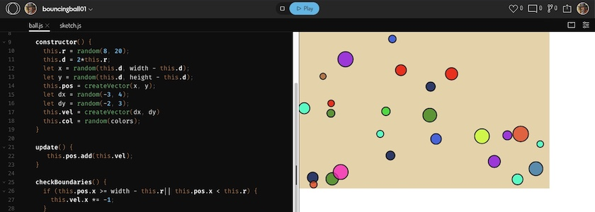
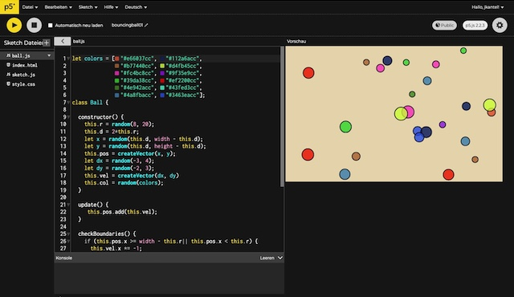
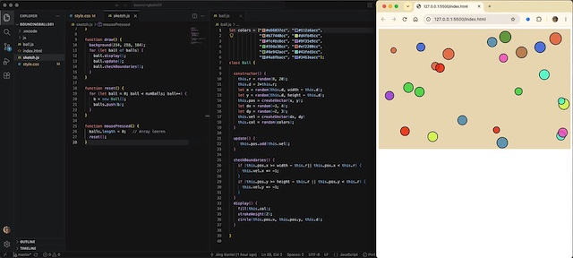

Vom hier auf diesen Seiten regelmäßig erwähnten »Freund aus Bremen« bekam ich den Hinweis, dass der [P5.js Webeditor](https://editor.p5js.org/) auf ein [neues Backend wechselt](https://discourse.processing.org/t/the-p5-js-editor-is-moving-to-a-new-backend-help-us-test-it/49748). Anstatt eigene Server zu verwenden, nutze der Editor künftig die API und Server von [OpenProcessing](https://openprocessing.org/). Momentan laufe ein öffentlicher Test, indem Nutzer mit einem OpenProcessing-Account aufgerufen werden, unter [editor-op.p5.js.org](https://editor-op.p5js.org/) das neue Backend zu testen.

Da ich zum einen ein chronisches Spielkalb bin und zum anderen noch einen mehr oder weniger brachliegenden OpenProcessing-Account besaß, ließ ich mir dies nicht zweimal sagen, und habe dieses [Bouncing-Balls-Programm](https://kantel.github.io/posts/2024033102_bouncing_balls_microstudio/), das ich vor über zwei Jahren einmal in [microStudio](http://cognitiones.kantel-chaos-team.de/multimedia/spieleprogrammierung/microstudio.html) mit Python (genauer mit [Brython](https://brython.info/)) implementiert hatte, nach [P5.js](http://cognitiones.kantel-chaos-team.de/programmierung/creativecoding/processing/p5js.html) portiert. Dabei musste ich feststellen, dass `editor-op.p5.js.org` mit meinem Chromebook noch ein wenig fremdelt (keine Syntax-Hervorhebung und manchmal Probleme beim Speichern), während zwei Tage später, als ich wieder an meinem Schreibtisch vor meinem betagten Mac Mini saß, die Programmierung wie geschmiert lief (siehe [Screenshot](https://www.flickr.com/photos/schockwellenreiter/55614209747/) oben). Aber der Editor ist ja auch noch Alpha, das Teil wird sicher noch verbessert.

Die dann an meinem Mac erstellt Version ließ sich auch problemlos in OpenProcessing öffnen (siehe [Bannerbild](https://www.flickr.com/photos/schockwellenreiter/55615374503/) ganz oben).

Natürlich wollt und sollt Ihr wissen, was ich da eigentlich angestellt habe. Zuerst habe ich eine Klasse `Ball`angelegt:

~~~js
let colors = ["#e66037cc", "#112a6acc",
              "#b77440cc", "#d4fb45cc",
              "#fc4bc8cc", "#9f35e9cc",
              "#39da38cc", "#ef2200cc",
              "#4e942acc", "#43fed3cc",
              "#4a8fbacc", "#3463eacc"];

class Ball {

  constructor() {
    this.r = random(8, 20);
    this.d = 2*this.r;
    let x = random(this.d, width - this.d);
    let y = random(this.d, height - this.d);
    this.pos = createVector(x, y);
    let dx = random(-3, 4);
    let dy = random(-2, 3);
    this.vel = createVector(dx, dy)
    this.col = random(colors);
  }

  update() {
     this.pos.add(this.vel);
  }

  checkBoundaries() {
    if (this.pos.x >= width - this.r|| this.pos.x < this.r) {
      this.vel.x *= -1;
    }
    if (this.pos.y >= height - this.r || this.pos.y < this.r) {
      this.vel.y *= -1;
    }
  }
  display() {
    fill(this.col);
    strokeWeight(2);
    circle(this.pos.x, this.pos.y, this.d);
  }
  
}
~~~

Die Klasse besitzt einen Positionsvektor (`pos`) und einen Geschwindigkeitsvektor (`vel` für *Velocity*). Das ist vielleicht ein wenig mit Kanonen auf Spatzen geschossen, aber ich liebe es nun einmal, mit Vektoren zu hantieren. Dadurch müssen in der `update()`-Methode nur die beiden Vektoren addiert werden.

Die Methode `checkBoudaries()` prüft, ob die Ränder berührt werden (Überraschung!). Um das möglichst genau hinzubekommen, wird dabei der Radius der Bälle berücksichtigt. Werden die Ränder getroffen, wird die Geschwindigkeit einfach umgekehrt (`vel *= -1`).

Wo ich die Farbpalette her hatte, weiß ich nicht mehr, aber mir gefallen die Farben mit ihrer leichten Transparenz für die Bälle.

Dadurch, dass die Klasse Ball eine eigene `update()`-, `checkBoundaries()`- und eine eigene `display()`-Methode besitzt, ist der Hauptsketch ziemlich kurz geraten:

~~~js
let numBalls = 25;
let balls = [];

function setup() {
  createCanvas(640, 400);
  // canvas = createCanvas(640, 400);   // für das Einbinden
  // canvas.parent("myCanvas");         // in diese Webseite
  reset();
}

function draw() {
  background(234, 218, 184);
  for (let ball of balls) {
    ball.display();
    ball.update();
    ball.checkBoundaries();
  }
}

function reset() {
  for (let ball = 0; ball < numBalls; ball++) {
    b = new Ball();
    balls.push(b);
  }
}

function mousePressed() {
  balls.length = 0;   // Array leeren
  reset();
}
~~~

Bemerkenswert ist hier nur die Funktion `reset()`, die nicht nur die initiale Füllung des Arrays `balls[]` vornimmt, sondern nach einem Mausklick den Sketch auch neu startet. Hierbei ist interessant, dass man mit dem Setzen eines Arrays auf die Länge von Null (`balls.length = 0;`) dieses Array komplett leert.

Nun sollt Ihr die hüpfenden Bälle auch auf dieser Seite bewundern können:

Wenn Ihr mit der Maus in den Sketch klickt, werden neue Bälle erzeugt und auf die hüpfende Reise geschickt. Probiert das ruhig aus.

Den Sketch habe ich [wie hier beschrieben](https://kantel.github.io/posts/2026080501_running_orcs/) mit `

` in diese Seite eingebunden. Lediglich die `class="if16_9"` habe ich weggelassen, da sie den eingebundenen Sketch doch nicht responsiv macht. (Wer hierfür eine Lösung weiß, die oder den bitte ich um Mitteilung in meinen Kommentaren.)

Damit das Einbinden funktioniert, müssen in `sketch.js` die Zeile

~~~js
createCanvas(640, 400);
~~~

durch die oben auskommentierten Zeilen

~~~js
canvas = createCanvas(640, 400);
canvas.parent("myCanvas");
~~~

ersetzt werden.

Natürlich gibt es diesen Sketch auch auf [OpenProcessing](https://openprocessing.org/@jkantel/3043956) und im neuen, noch im Alpha-Stadium sich befindenden [P5.js Webeditor](https://editor-op.p5js.org/jkantel/sketches/3043956). Und auch auf meiner Neocities-P5.js-Spielwiese ist [der Sketch zu finden](https://kantel.neocities.org/p5projects/Bouncing%20Balls/).

Wer es mehr traditionell mag: [Hier gibt es den Code](https://github.com/kantel/p5js/tree/master/bouncingballs01) auch auf GitHub.

## Wie geht es mit dem P5.js Webeditor weiter?

Nach dem Ende der öffentlichen Testphase gibt es demnächst einen nicht öffentlichen Mitarbeiter- und Wartungstest.

Danach soll die vollständige Umstellung auf das neue OpenProcessing-Backend erfolgen (frühestens am **15.&nbsp;Dezember&nbsp;2026**) und alle Konten werden migriert. Dabei bleiben  OpenProcessing.org und der P5.js-Webeditor separate Tools. Diese Zusammenarbeit betrifft ausschließlich die Backend-Prozesse des P5.js-Editors. Die Umstellung erfolgt automatisch. Wer dies nicht will, sollte seine Sketche vorher herunterladen, woanders hosten und sie danach im Webeditor löschen.

Es gibt folgende zukünftige Änderungen und Versprechen bezüglich der Datenschutzrichtlinien und der Nutzungsbedingungen:

- Eure Sketche und Kontoinformationen werden von OpenProcessing gespeichert.
- Die Processing Foundation wird zu *Fathom Analytics* wechseln, das [keine Cookies](https://usefathom.com/why-fathom-analytics/privacy-focused-web-analytics) für Webanalysen verwendet.
- Die Processing Foundation wird Dienste entfernen, die sie nicht mehr nutzt.
- Die Processing Foundation wird die Datenschutzrichtlinie präzisieren, um genau festzulegen, welche Daten sie erheben und welche nicht.

Die Seite mit der [Ankündigung des Wechsels auf das neue Backend](https://discourse.processing.org/t/the-p5-js-editor-is-moving-to-a-new-backend-help-us-test-it/49748) wird regelmäßig aktualisiert werden, um auf neu aufkommende Fragen einzugehen.

## P5.js und VSCodium

Doch wartet, da ist noch mehr:

[Hier](https://kantel.github.io/posts/2026080501_running_orcs/) hatte ich ja mit P5.js und dem Editor [Phoenix Code](https://phcode.io/) experimentiert. Im Großen und Ganzen erfüllte er [meine an ihn gestellten Erwartungen](https://kantel.github.io/posts/2026073001_phoenix_code/), Lediglich eine Syntax-Hervorhebung und eine Fehlererkennung für P5.js, wie sie [p5.vscode](https://github.com/antiboredom/p5.vscode#readme), eine Erweiterung für [Visual Studio Code](http://cognitiones.kantel-chaos-team.de/produktivitaet/visualstudiocode.html), bietet, hatte ich vermisst. Nicht, dass ich mit Visual Studio Code unzufrieden wäre, aber ich habe mehr und mehr die Befürchtung, dass sich die ganzen Erweiterungen irgendwann einmal in die Quere kommen. Daher habe ich es einmal mit [VSCodium](https://vscodium.com/), der freien (MIT-Lizenz), zu Visual Studio Code weitestgehend kompatiblen, aber weniger geschwätzigen Alternative probiert.

Als Erweiterung habe ich den [p5.js 2.x Project Generator](https://marketplace.visualstudio.com/items?itemName=Irti.p5js-project-generator) und den [VS Code Live Server](https://marketplace.visualstudio.com/items?itemName=ritwickdey.LiveServer) installiert (beides hat mir VSCodium vorgeschlagen).

Ich muss gestehen, ich bin begeistert: Keine Abhängigkeit von Microsoft mehr, kein Editor, der ungefragt nach Hause telephoniert, und die gewohnten Syntax-Hervorhebungen und Fehlererkennung auch für P5.js.

So schön OpenProcessing und der P5.js Webeditor auch sind: Sie liegen auf US-amerikanischen Servern und das steht einer Digitalen Souveränität im Wege. Daher freue ich mich, mit VSCodium einen Schritt weiter in Richtung meiner digitaler Unabhängigkeit gekommen zu sein.

