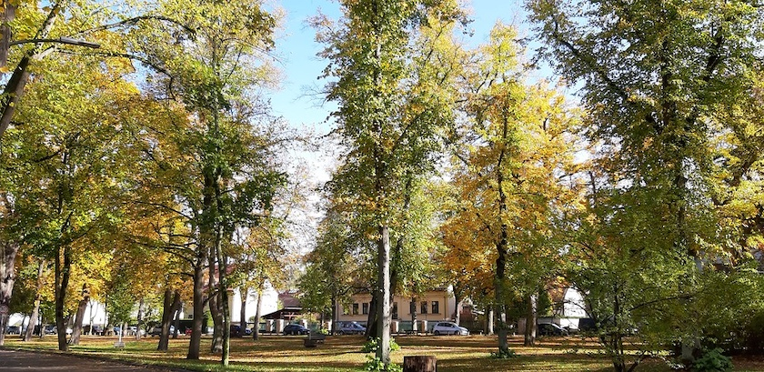

Über den [Dorfanger in Berlin-Heiligensee](https://kantel.github.io/posts/2026010701_alt-heiligensee/) hatte ich ja Anfang dieses Jahres schon einmal einen Beitrag. Nun neigt sich das Jahr mit einem (hoffentlich!) goldenen Oktober dem Ende zu, und die liebste aller Freundinnen hat in der letzten Woche ein Photo des herbstlich-bunten Dorfangers geschossen, das ich Euch nicht vorenthalten möchte.

Heiligensee besitzt nicht nur den längsten Dorfanger Berlins, sondern um den namensgebenden See ranken sich auch [viele Sagen](https://kantel.github.io/posts/2026061001_heiligensee/). Und das [Restaurant im Seebad Heiligensee](https://www.berlin.de/tourismus/seen/4843649-4299185-heiligensee.html), Sandhauser Straße&nbsp;132, 13503&nbsp;Berlin, ist mit seiner rustikalen, gutbürgerlichen Küche auch immer einen Besuch wert. Wir wissen das, denn wir waren am letzten Wochenende wieder einmal dort.

---

**Photo** &copy; 2026: *Marianne L.*

