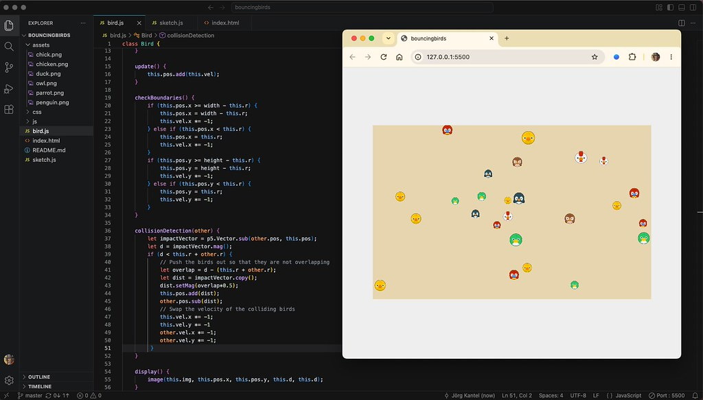

Das vor [zwei Tagen vorgestellte Skript](https://kantel.github.io/posts/2026102701_p5js_webeditor_neu/) »Bouncing Balls« war für (m)einen Einstieg in [P5.js](http://cognitiones.kantel-chaos-team.de/programmierung/creativecoding/processing/p5js.html) zwar amüsant, aber ihm fehlte doch ein wichtiges Element: Die Bälle prallten zwar von den Rändern ab, nahmen aber gegenseitig keine Notiz voneinander -- sie überlappten sich nach Belieben. Also musste eine Kollisionserkennung her.

Die Kollisionserkennung zweier Kreise ist im Prinzip recht einfach: Wenn der Abstand zweier Kreise (gemessen vom Mittelpunkt) größer ist als die Summe der beiden Radii, dann kollidieren beide Kreise **nicht**. Ist er jedoch kleiner, dann überschneiden sich beide Kreise und eine Kollision liegt vor. Im Pseudecode (Python) sieht das so aus:

~~~python
def is_circle_collision(self, other):
    distance = math.dist([self.loc.x, self.loc.y], [other.loc.x, other.loc.y])
    if distance < self.r + other.r:
      return True
    return False
~~~

In meinem Skript werden die Kreise durch Bilder kreisrunder Vogelköpfe ersetzt (mehr dazu unten).

So nackt hat die Methode jedoch einen Nachteil: In etlichen Fällen kann es vorkommen, das sich die Kreise »verheddern« und nur schwer wieder zu trennen sind. Das liegt daran, dass -- bedingt durch die Euler-Integration und die Framerate von 60 FPS -- bei einer Kollision sich die Kreise so weit überschneiden, dass sie auch beim nächsten (oder über- (über-)) nächsten Schritt immer noch kollidieren.

Die Lösung ist aus der Spieleprogrammierung eigentlich bekannt: Bei einer Kollision setzt man die Akteure (die Kreise oder auch die Sprites/Vögel) soweit auf die Position zurück, dass sie sich zwar gerade noch berühren, aber nicht mehr überlappen. *Daniel Shiffman* hat das in seiner 184.&nbsp;Coding Challenge »[Collisions Without a Physics Library!](https://www.youtube.com/watch?v=dJNFPv9Mj-Y)« wunderbar erklärt. In P5.js kann eine Lösung dann so aussehen:

~~~js
collisionDetection(other) {
        let impactVector = p5.Vector.sub(other.pos, this.pos);
        let d = impactVector.mag();
        if (d < this.r + other.r) {
            // Push the birds out so that they are not overlapping  
            let overlap = d - (this.r + other.r);
            let dist = impactVector.copy(); 
            dist.setMag(overlap*0.5);
            this.pos.add(dist);
            other.pos.sub(dist);
        }
}
~~~

Zuerst wird die Länge der Überlappung festgestellt und dann von dem einen Vogel die Hälfte dieser Überlappung aufaddiert und bei dem anderen Vogel die Hälfte der Überlappung abgezogen. Und schon prallen die beiden Vögel zwar aufeinander, aber sie überschneiden sich nicht mehr.

Als Kollisionsergebnis habe ich eine Reaktion gewählt, die von diesem Video »[Python Bouncing Ball Simulator 5](https://www.youtube.com/watch?v=Pl_w9qSgMGY)« von *Christian Thompson* (aka *TokyoEdtech* – langjährige Leser des *Schockwellenreiters* wissen Bescheid, das ist der Mann, der Unglaubliches aus Pythons Turtle herauskitzelte) inspiriert wurde: Bei einer Kollision wird einfach die Velocity der beiden beteiligten Kreise getauscht. Das ist zwar nicht wirklich eine exakte (ideale) elastische Kollision, kommt Ihr aber relativ nahe[^1] (die folgenden Zeilen im Code *direkt hinter* der Zeile `other.pos.sub(dist);` einfügen):

[^1]: Wer eine genauere Simulation einer elastischen Kollision (eines (in diesem Falle zweidimensionalen) elastischen Stoß) implementieren will, kann sich ja an [Shiffmans Implementierung](https://editor.p5js.org/codingtrain/sketches/3DrBb8LCp) orientieren. Oder sie oder er greifen gleich zu einer Physik Engine wie [Matter.js](https://brm.io/matter-js/).

~~~js
            // Swap the velocity of the colliding birds
            let tempX = other.vel.x;
            let tempY = other.vel.y;
            other.vel.x = this.vel.x;
            other.vel.y = this.vel.y;
            this.vel.x = tempX;
            this.vel.y = tempY;
~~~

Die Hauptarbeit des Sketches wird in der Klasse `Bird` erledigt, die trotz aller Verbesserungen immer noch große Ähnlichkeit mit der Klasse `Ball` der Vorgängerversion besitzt:

~~~js
class Bird {

    constructor() {
        this.r = random(10, 16);
        this.d = 2*this.r;
        let x = random(this.d, width - this.d);
        let y = random(this.d, height - this.d);
        this.pos = createVector(x, y);
        let dx = random(-3, 4);
        let dy = random(-2, 3);
        this.vel = createVector(dx, dy);
        this.img = random(birdsIm);
    }

    update() {
        this.pos.add(this.vel);
    }

    checkBoundaries() {
        if (this.pos.x >= width - this.r) {
            this.pos.x = width - this.r;
            this.vel.x *= -1;
        } else if (this.pos.x < this.r) {
            this.pos.x = this.r;
            this.vel.x *= -1;
        }
        if (this.pos.y >= height - this.r) {
            this.pos.y = height - this.r;
            this.vel.y *= -1;
        } else if (this.pos.y < this.r) {
            this.pos.y = this.r;
            this.vel.y *= -1;
        }
    }

    collisionDetection(other) {
        let impactVector = p5.Vector.sub(other.pos, this.pos);
        let d = impactVector.mag();
        if (d < this.r + other.r) {
            // Push the birds out so that they are not overlapping  
            let overlap = d - (this.r + other.r);
            let dist = impactVector.copy(); 
            dist.setMag(overlap*0.5);
            this.pos.add(dist);
            other.pos.sub(dist);
            // Swap the velocity of the colliding birds
            let tempX = other.vel.x;
            let tempY = other.vel.y;
            other.vel.x = this.vel.x;
            other.vel.y = this.vel.y;
            this.vel.x = tempX;
            this.vel.y = tempY;
         }
    }

    display() {
        image(this.img, this.pos.x, this.pos.y, this.d, this.d);
    }
}
~~~ 

Auch bei der Methode `checkBoundaries()` bin ich dieses Mal genauer, als bei der Vorgängerversion: Wenn der Wert kleiner oder gleich der Position des Bodens oder der Seitenwände ist, wird er exakt auf die Position des Bodens oder der Seitenwände gesetzt[^2].

[^2]: Dadurch werden auch hier mögliche Glitches beseitigt, die von der Euler-Integration und der Framerate von (maximal) 60 FPS hervorgerufen werden könnten.

Das (wieder recht kurze) Hauptprogramm sieht dann so aus:

~~~js
let numBirds = 25;
let birds = [];
let birdsIm = [];

let img;

async function setup() {

    // load the bird images
    img = await loadImage("assets/chick.png");
    birdsIm.push(img);
    img = await loadImage("assets/chicken.png");
    birdsIm.push(img);
    img = await loadImage("assets/duck.png");
    birdsIm.push(img);
    img = await loadImage("assets/owl.png");
    birdsIm.push(img);
    img = await loadImage("assets/parrot.png");
    birdsIm.push(img);
    img = await loadImage("assets/penguin.png");
    birdsIm.push(img);
    // console.log("Alle Bilder geladen.");

    createCanvas(640, 400);
    // canvas = createCanvas(640, 400);   // für das Einbinden
    // canvas.parent("myCanvas");         // in diese Webseite
    imageMode(CENTER);
    reset();
}

function draw() {
    background(234, 218, 184);
    for (let i = 0; i < numBirds; i++) {
        for (let j = i + 1; j < numBirds; j++) {
            birds[i].collisionDetection(birds[j]); 
        }
        birds[i].checkBoundaries();
        birds[i].update();
        birds[i].display();
    }
}

function reset() {
  for (let bird = 0; bird < numBirds; bird++) {
    b = new Bird();
    birds.push(b);
  }
}

function mousePressed() {
  birds.length = 0;   // Array leeren
  reset();
}
~~~

Es hat zwei Besonderheiten: Erstens habe ich zum Laden der Bilder das Kommandopaar `async` … `await` genutzt, das in P5.js die seperate Funktion `preload()` überflüssig macht. Die Bilder werden im Array `birdsIm` gespeichert und dann im `constructor()` der Klasse `Bird` in der Zeile

~~~js
this.img = random(birdsIm);
~~~

zufällig einem Vogel zugeschrieben.

Auch musste ich auf das schöne Schleifenkonstrukt `for (let bird of birds) {}` in der Funktion `draw()` verzichten, da ich für die Kollisionserkennung das Array `birds[]` zweimal durchlaufen musste[^3]:

[^3]: Natrlich hätte ich auch in einer zweiten Schleife mit `for (let bird of birds) {}` die Methoden `checkBoundaries()`, `update()` und `display()` separat aufrufen können, aber so schien mir das logischer.

~~~js
    for (let i = 0; i < numBirds; i++) {
        for (let j = i + 1; j < numBirds; j++) {
            birds[i].collisionDetection(birds[j]); 
        }
~~~

Die zweite Schleife durchläuft das Array nur von `i + 1` bis `numBirds`, da alle anderen Kollisionsmöglichkeiten ja vorher schon abgefragt wurden.

Und hier wieder der Sketch in seiner ganzen Schönheit (mit einem Mausklick in den Canvas könnt Ihr ihn neu starten):

Die Bilder der kreisrunden Vogelköpfe stammen aus dem freien ([CC0](https://creativecommons.org/publicdomain/zero/1.0/)) [Animal Pack Remastert](https://kenney.nl/assets/animal-pack-remastered) des schier unerschöpflichen Fundus von *Kenney*.

Wie Ihr aus dem [Bannerbild](https://www.flickr.com/photos/schockwellenreiter/55617280522/) oben erkennen könnt, habe ich auch diesen Sketch wieder mit [VSCodium](https://vscodium.com/), der freien (MIT-Lizenz) Alternative zu Visual Studio Code mit den Erweiterungen [p5.js 2.x Project Generator](https://marketplace.visualstudio.com/items?itemName=Irti.p5js-project-generator) und [VS Code Live Server](https://marketplace.visualstudio.com/items?itemName=ritwickdey.LiveServer) entwickelt. Und ich bin sehr zufrieden damit. Man bekommt aussagekräftige Fehlermeldungen im `Problems`-Tab wie auch zur Laufzeit in der JavaScript-Konsole des Browsers[^4] angezeigt. Es ist also wirklich ein guter Ersatz für den P5&nbsp;Webeditor und das Teil gibt Euch ein wenig von Eurer digitalen Souveränität zurück.

[^4]: Hier sollte man aber besser mit `console.log()` und nicht mit `print()` hantieren. Denn dann bekommt man auch die korrekte Datei und die richtige Zeilennummer angezeigt, während `print()` zwar funktioniert, aber alles in `p5.min.js: line 1` verortet.

Wer nachlesen oder selber ein wenig damit spielen will: Ich habe diesen Sketch mit allen Assets auch auf [GitHub](https://github.com/kantel/p5js/tree/master/bouncingbirds) und meiner [Neocities-Spielwiese](https://kantel.neocities.org/p5projects/Bouncing%20Birds/) hochgeladen. Dort findet Ihr nicht nur das fertige Ergebnis, sondern auch den Quellcode.