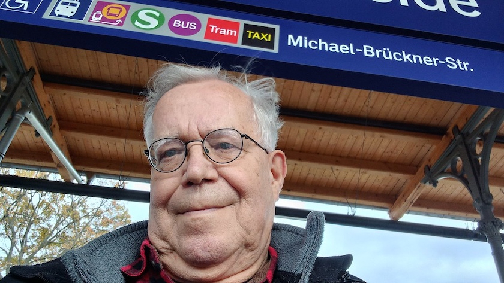

Dieses Mal hatte die Berliner S-Bahn eine ganz exquisite Entschuldigung, warum der Bahnbetrieb in den Berliner Südosten so unzuverlässig lief: Weil ein Erfüllungsgehilfe einer durch und durch korrupten, osteuropäischen Oligarchie auf »Staatsbesuch« in Berlin weilte, hat man, statt ihn zu verhaften, den [Verkehr in der Hauptstadt lahmgelegt](https://www.tagesspiegel.de/berlin/selenskyj-besucht-berlin-sicherheitskonferenz-fuhrt-zu-verkehrseinschrankungen--lange-staus-auf-mehreren-strassen-16233702.html).

Aber irgendwie hatte ich es dennoch, wenn auch mit gebührender Verspätung, nach ~~Schweineöde~~ Schöneweide geschafft und die Berliner Haarschneiderinnen meines Vertrauens, die [Coiffeure Marina & Team](https://www.facebook.com/coiffeuremarinaundteam/?locale=de_DE) *(Facebook-Link)*, konnten mir wieder die Haare schön machen. Schließlich waren seit dem [letzten Mal](https://kantel.github.io/posts/2026090801_haare_schoen/) schon wieder fast acht Wochen vergangen.

Und in sechs bis acht Wochen geht es dann weiter mit den unendlichen Geschichten rund um korrupte Oligarchien, [versagende Berliner Bahnhofsbauten](https://de.wikipedia.org/wiki/Bahnhof_Berlin-Sch%C3%B6neweide#Umbau) und meine Versuche, mich dennoch nach Schöneweide durchzuschlagen.

---

**Photo** ([cc](https://creativecommons.org/licenses/by-sa/4.0/deed.de)) 2026: *[Jörg Kantel](http://cognitiones.kantel-chaos-team.de/cv.html)*