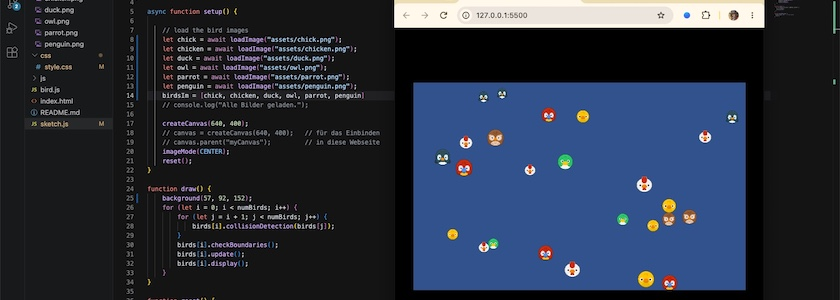

Mir ist über das Wochenende noch eingefallen, wie ich den Code für das [Beispiel mit den aufeinanderprallenden Vogelköpfen](https://kantel.github.io/posts/2026102901_bouncing_birds_p5js/) vom letzten Donnerstag noch verbessern kann. (Ich fremdel halt noch ein wenig mit JavaScript.) Und zwar betrifft dies die `setup()`-Funktion: Statt das Bild jeden Vogels einzeln in einer Variablen `img` zu laden und dann per `push(img)` in das Array `birdsIm[]` einzufügen, kann ich ja auch jeden Vogel einzeln in lokalen Variablen laden und dann alle Vogelbilder in **einer** Zuweisung in das Array einfügen:

~~~js
async function setup() {

    // load the bird images
    let chick = await loadImage("assets/chick.png");
    let chicken = await loadImage("assets/chicken.png");
    let duck = await loadImage("assets/duck.png");
    let owl = await loadImage("assets/owl.png");
    let parrot = await loadImage("assets/parrot.png");
    let penguin = await loadImage("assets/penguin.png");
    birdsIm = [chick, chicken, duck, owl, parrot, penguin]
    // console.log("Alle Bilder geladen.");

    createCanvas(640, 400);
    // canvas = createCanvas(640, 400);   // für das Einbinden
    // canvas.parent("myCanvas");         // in diese Webseite
    imageMode(CENTER);
    reset();
}
~~~

Dadurch habe ich immerhin sechs Zeilen Code gespart (da die globale Deklaration der Variablen `img` ebenfalls entfällt).