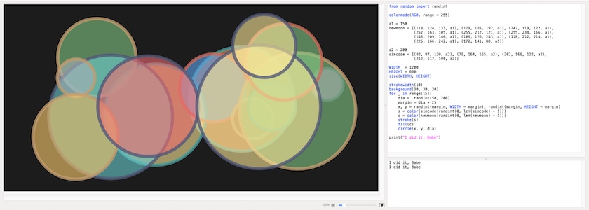
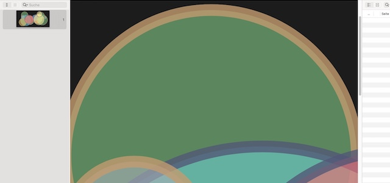

Da flatterte doch gestern Abend ein Nachricht in meine Mailbox, dass von der [Nodebox&nbsp;1](http://cognitiones.kantel-chaos-team.de/programmierung/creativecoding/nodebox/nodebox.html) in der Fork von *Karsten Wolf* nach über zweijähriger Pause die [Version 1.10.3](https://github.com/karstenw/nodebox-pyobjc/releases/tag/v1.10.3) erschienen sei. Es müssen schon sehr treue Leser dieses ~~Blogs~~ Kritzelhefts sein, die sich noch erinnern. Nodebox&nbsp;1 ist ein freies (MIT-Lizenz) macOS-Programm für die kreative Graphikprogrammierung (statische, animierte und interaktive Graphiken). Es nutzt Python als Skriptsprache und kann die Ergebnisse wahlweise als PDF (auch mehrseitige) oder als QuickTime-Movie exportieren, aber auch TIFF, PNG oder JPEG herausschreiben.

Nachdem die »[offizielle NodeBox 1](https://nodebox.net/code/Home)« keine Weiterentwicklung mehr erfahren hatte, hat *Karsten Wolf* [eine Fork angelegt](https://github.com/karstenw/nodebox-pyobjc), und wie man sieht, pflegt er sie -- wenn auch mit langen Pausen -- unermüdlich weiter. Ich hatte damals auch sehr viel mit dem Teil (von mir liebevoll »Tropfenschachel« genannt) angestellt und stand in häufigem Kontakt mit Karsten. So trägt auch ein Verzeichnis in den mitgelieferten Beispiel-Applikationen den Namen `schockwellenreiter.de`. 

NodeBox&nbsp;1 ist eine Weiterentwicklung von [DrawBot](http://cognitiones.kantel-chaos-team.de/programmierung/creativecoding/drawbot.html) und wie diese eine Mac-only-Anwendung (da mit PyObjC erstellt). Aber da beide Programme Vektrographiken erzeugen, die verlustfrei skalierbar sind, sind sie wie geeignet für mein Projekt »[Generative Art auf Papier und zwischen zwei Pappedeckel gepreßt](http://blog.schockwellenreiter.de/2022/03/2022031101.html)«, mit dem ich dem glücklicherweise mittlerweile wieder abklingenden NFT-Hype den Stinkefinger zeigen wollte.

Das Ganze kommt natürlich zur Unzeit: Ich schlage mich gerade mit der Frage herum, wie ich [P5.js](http://cognitiones.kantel-chaos-team.de/programmierung/creativecoding/processing/p5js.html) dazu überreden kann, seine Ergebnisse als PDF oder SVG zu erzeugen, so dass auch diese verlustfrei hochskaliert werden können. In [Processing](http://cognitiones.kantel-chaos-team.de/programmierung/creativecoding/processing/processing.html)(.[py](http://cognitiones.kantel-chaos-team.de/programmierung/creativecoding/processing/processingpy.html))/[Py5](http://cognitiones.kantel-chaos-team.de/programmierung/creativecoding/processing/py5.html) war mir dies ja schon einmal [gelungen](http://blog.schockwellenreiter.de/2022/07/2022072201.html), und auch in [TigerJython](http://cognitiones.kantel-chaos-team.de/programmierung/python/tigerjython.html) war ich da (mit Abstrichen) [erfolgreich](http://blog.schockwellenreiter.de/2022/07/2022072301.html).

Aber auf der anderen Seite: Wenn das Ergebnis sowieso für den Print-Bereich gedacht ist, ist das Werkzeug, mit dem es erzeugt wird, eigentlich Nebensache. (Ich sehe mich schon wieder sehenden Auges in die Mac-only-Falle tappen.) Aber NodeBox&nbsp;1 wie auch DrawBot sind einfach zu nette Werkzeuge, die zuviel Spaß machen, als das ich sie einfach ignorieren könnte.

Also habe ich mir NodeBox&nbsp;1 heruntergeladen. Ich weiß nicht, ob es an dem großen Andrang kurz nach der Veröffentlichung lag, der Download dauerte jedenfalls ziemlich lange (die Datei war aber auch fett). Die Applikation kommt mit zwei Binaries, `NodeBox_arm.app` und `NodeBox_intel.app`. Entgegen dem Namen soll die ARM-Applikationen auch mit einingen Intel-Maschinen laufen, Karsten weiß allerdings nicht, ab welcher OS-Version (er schätzt ab 10.15+, aber er hat die Maschinen nicht, um das zu testen). Ich kann ein wenig Klarheit bringen, mein (Intel-) Mac-Mini läuft mit macOS 15.7.9, und der schluckt die ARM-Version nicht.

Also habe ich die App mit der Intel-Version gestartet (und die üblichen Apple-Sicherheitsspielchen durchgeführt) und dann -- das ist wichtig -- in den Settings den Library-Folder auf den Pfad der bei der Applikation mitgelieferten gesetzt. Bei mir war das `/Applications/NodeBox 1.10.3/Library`.

Dann habe ich die Tropfenschachtel geschlossen und wieder neu gestartet, und aus der mitgelieferten Bibliothek das Programm `Library/linguistics/DOWNLOAD_DATABASES_AND_INSTALL_CONCEPTNET.py` angeworfen. Dieses Skript initialisiert wohl einige Datenbanken, die für den Betrieb der Bibliotheken erforderlich sind.

Das war dann aber alles. Jetzt habe ich wieder eine funktionierende Tropfenschachtel, die neben den oben angesprochenen Ziel, generative Kunst für die Ausgabe zwischen zwei Pappedeckel zu erzeugen, sicher auch als einfach zu bedienender Ersatz für das leider sanft entschlafene Processing.py dienen kann (für diejenigen, denen Py5 zu komplex ist). Schaun wir mal, was ich damit noch alles anstellen werde. *Still digging!*