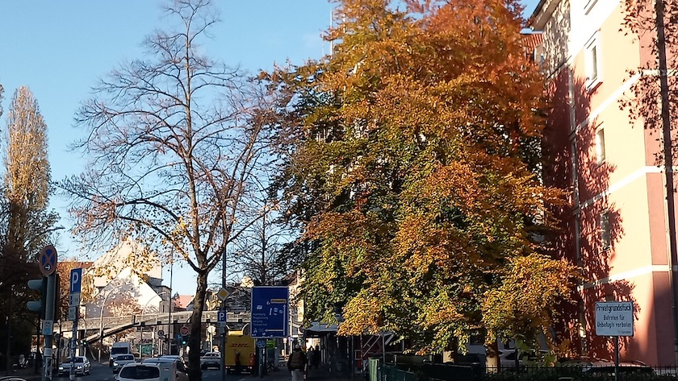

Glaubt man den Wetterfröschen -- aber wer glaubt ihnen schon -- war das heute der letzte, sonnige Herbsttag in diesem Jahr. Daher bin ich noch einmal raus und habe ein Photo dieses herbstbunten Baumes am Britzer Damm geschossen.

Nach all den Hiobsbotschaften aus der Politik (und dem Polizeibericht) soll dieses Bild zeigen, dass Neukölln auch schön sein kann. Ich lebe ([immer noch](https://www.zeit.de/online/2006/14/Neukoelln/komplettansicht)) gerne hier.

---

**Photo** ([cc](https://creativecommons.org/licenses/by-sa/4.0/deed.de)) 2026: *[Jörg Kantel](http://cognitiones.kantel-chaos-team.de/cv.html)*