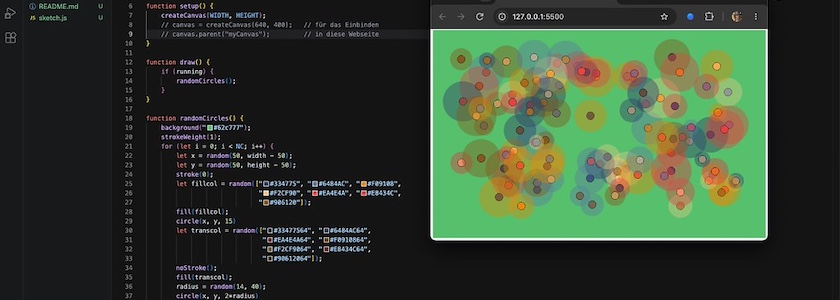
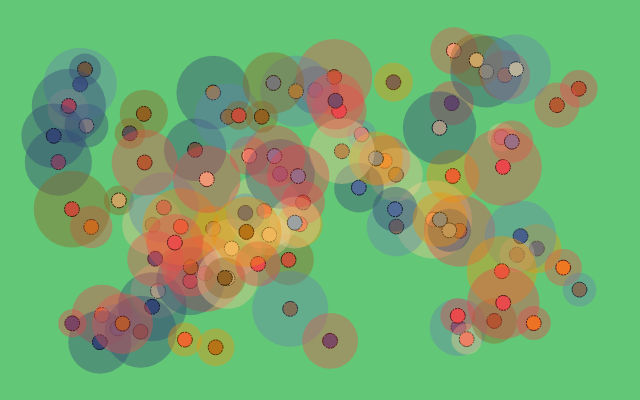

Die [gestern wiederentdeckten](https://kantel.github.io/posts/2026110402_nodebox_1_first_final_release/) und freudig begrüßte [Knotenschachtel](http://cognitiones.kantel-chaos-team.de/programmierung/creativecoding/nodebox/nodebox.html) wird auf einmal ganz schnell relevant, da es mir entgegen meinen Erwartungen nicht gelungen ist, [P5.js](http://cognitiones.kantel-chaos-team.de/programmierung/creativecoding/processing/p5js.html) dazu zu überreden, Bilder als Vektorgraphiken abzuspeichern, die es erlauben, sie verlustfrei hochzuskalieren, um sie damit zum Beispiel in Print-Projekten wie »[Generative Art auf Papier und zwischen zwei Pappedeckel gepreßt](http://blog.schockwellenreiter.de/2022/03/2022031101.html)« zu nutzen.

Was habe ich versucht? Ich habe das Python-Skript aus [meinen alten Versuchen](http://blog.schockwellenreiter.de/2022/07/2022072201.html) nach P5.js portiert und dann nach Libraries für den PDF-, respeketive SVG-Export gesucht. Leider erfolglos. Die einzige Methode, die ich gefunden habe, bestand aus einer Kombination aus den Modulen [p5.pdf](https://github.com/zenozeng/p5.js-pdf) und [p5.js-svg](https://github.com/zenozeng/p5.js-svg/). Doch während ich `p5.pdf` noch lokal herunterladen und in meinen Sketch einbinden konnte, ließ sich `p5.js-svg` nur über

~~~html

~~~

einbinden. Und dieser Server scheint nicht mehr zu existieren (oder das Modul nicht mehr mit P5.js&nbsp;2.x zusammenzuspielen). Jedenfalls bekam ich die Fehlermeldung, dass das Modul nicht geladen werden konnte.

Dann gab es von *Golan Levin* noch das Modul [p5.plotSvg](https://github.com/golanlevin/p5.plotSvg). Das funktionierte im Prinzip hervorragend, jedoch ist es für das Zusammenspiel mit Stiftplottern konzipiert. Die erzeugten SVGs sind nur schwarzweiße Kreise ohne jede Farbinformation. Das war auch nicht wirklich das, was ich wollte.

Wenn irgendjemand von Euch da draußen noch eine Idee hat, wie das Problem zu lösen ist, die oder den bitte ich um Hinweise in meinen Kommentaren. (Der diesjährige *Google Summer of Code* (GSoC) soll einen neuen Anlauf in diese Richtung unternommen haben, also scheint die Lage nicht absolut hoffnungslos).

## Der Code 

Natürlich will ich Euch nicht den Code vorenthalten, mit dem ich all meine Versuche unternommen habe:

~~~js
const WIDTH = 640;
const HEIGHT = 400;
const NC = 100;      // Number of Circles
let running = true;

function setup() {
    createCanvas(WIDTH, HEIGHT);
    // canvas = createCanvas(640, 400);   // für das Einbinden
    // canvas.parent("myCanvas");         // in diese Webseite 
}

function draw() {
    if (running) {
        randomCircles();
    }
}
    
function randomCircles() {
    background("#62c777");
    strokeWeight(1);
    for (let i = 0; i < NC; i++) {
        let x = random(50, width - 50);
        let y = random(50, height - 50); 
        stroke(0);
        let fillcol = random(["#334775", "#6484AC", "#F09108",
                              "#F2CF90", "#EA4E4A", "#E8434C",
                              "#906120"]);                            
        fill(fillcol);
        circle(x, y, 15)
        let transcol = random(["#33477564", "#6484AC64", 
                               "#EA4E4A64", "#F0910864",
                               "#F2CF9064", "#E8434C64",
                               "#90612064"]);
        noStroke();
        fill(transcol);
        radius = random(14, 40);
        circle(x, y, 2*radius)
    }
    // draw() anhalten und Frame speichern
    save("randomcircles.png"); 
    console.log("After Save");
    running = false;
}

function mousePressed() {
    running = true;
}
~~~

Die Funktion `draw()` wird nach jedem Durchlauf angehalten (`running = false`), damit das enstandene Bild mit 

~~~js
save("filename.png");
~~~

als PNG gespeichert werden kann. Die Funktion `save()` kann neben PNGs auch JPGs abspeichern. Das Format erkennt sie an der Datei-Endung[^1]. Das Ergebnis eines Durchlaufs seht Ihr oben. Zum Einbinden in eine Webseite mag es noch geeignet sein, aber auf gar keinen Fall für die Verwendung in einem Print-Produkt.

[^1]: Die Funktion [save()](https://p5js.org/reference/p5/save/) kann noch mehr. Neben Bildern kann sie auch Text, JSON, CSV oder HTML, aber leider weder PNG noch SVG.

Drückt mir die Daumen, dass ich dafür doch noch eine Lösung finde. *Still digging!*