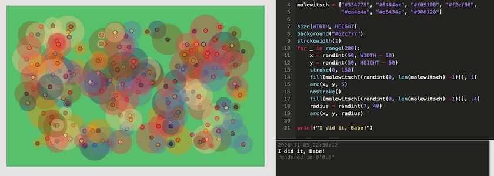
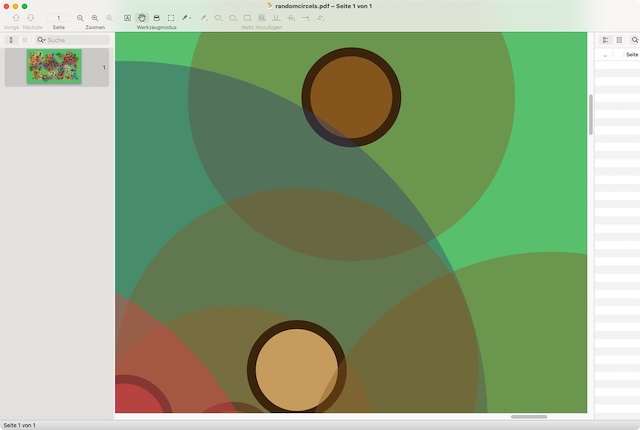
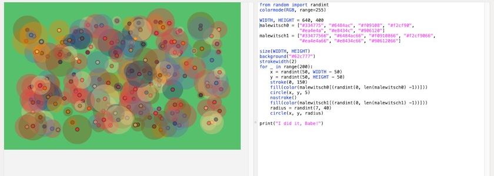
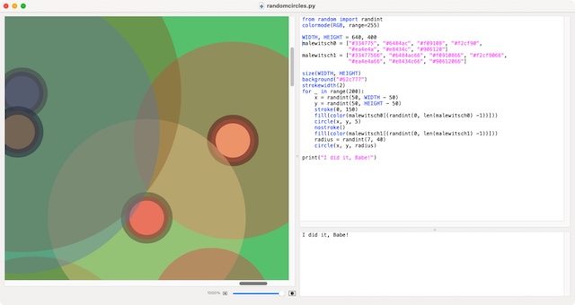

Nach dem [vergeblichen Versuch gestern](https://kantel.github.io/posts/2026110502_no_svg_pdf_mit_p5js/), [P5.js](http://cognitiones.kantel-chaos-team.de/programmierung/creativecoding/processing/p5js.html) zu überreden, Bilder als Vektorgraphiken abzuspeichern, rumorte es ständig in meinem Hinterkopf: Gab es da nicht noch einen Knotenschachtel-Klon? Richtig! Er heißt **[PlotDevice](https://plotdevice.io/)**.

**[PlotDevice](http://cognitiones.kantel-chaos-team.de/programmierung/creativecoding/nodebox/plotdevice.html)** (MIT-Lizenz) ist eine weitere Fork von NodeBox&nbsp;1, der interaktiven 2D-Graphik-Umgebung für macOS, die mit PyObjC alle Möglichkeiten des Macintosh-Betriebssystems voll ausnutzt. Sie ist mit dem Original-Nodebox rückwärtskompatibel, es laufen auch einige – nicht alle – alten Bibliotheken, die GUI ist aber stärker von Processing beeinflusst. Die Dokumentation zu PlotDevice ist hervorragend und vollständig.

Ich hatte mit PlotDevice vor elf Jahren mal ein wenig [herumgespielt](http://blog.schockwellenreiter.de/essays/plotdevicenumpy.html) und war trotz einiger guten Ideen, die das Teil realisiert hatte, enttäuscht. Denn die Integration der NodeBox&nbsp;1-Bibliotheken war zwar versprochen, aber [schlampig realisiert](http://blog.schockwellenreiter.de/2015/10/2015102803.html) (und »schlampig« war noch gestrunzt). Das führte dazu, daß ich in den Folgejahren nur noch die [Dokumentation](https://plotdevice.io/manual) von PlotDevice genutzt hatte, denn die war -- auch wenn vieles davon nicht in PlotDevice, sondern nur in *Karsten Wolfs* [NodeBox-Fork](https://kantel.github.io/posts/2026110402_nodebox_1_first_final_release/) funktionierte -- um Klassen besser als die Original NodeBox&nbsp;1-Dokumentation[^1].

[^1]: Das hat sich mittlerweile verbessert: Bevor NodeBox&nbsp;1 zugunsten von NodeBox&nbsp;3 in ein [Archiv abgeschoben und eingefroren wurde](https://nodebox.net/code/Home), hatte sich jemand der Dokumentation angenommen und sie auf den damaligen Stand gebracht und alle Fehler (das waren in der Hauptsache im Daten-Nirwana verschwunden Bilder) ausgemerzt.

Aber *tempus fuget*: Im Sommer 2022 wurde PlotDevice mit der [Version 1.1.0](https://github.com/plotdevice/plotdevice/releases/tag/v1.0.0) gründlich [überholt](https://github.com/plotdevice/plotdevice) und auch die Dokumentation, welche NodeBox&nbsp;1-Bibliotheken nun mit PlotDevice laufen und was es unter Umständen zu beachten gilt, wurde auf einer [eigenen Seite aktualisiert](https://github.com/plotdevice/plotdevice-libs)[^2] (dort kann man die Bibliotheken (auch einzeln) herunterladen).

[^2]: Das gilt übrigens auch für die NodeBox&nbsp;1-Fork von *Karsten Wolf*: Auch er hat eine [NodeBox Library](https://github.com/karstenw/Library)-Seite, in der nicht nur die »klassischen« NodeBox&nbsp;1-Bibliotheken aufgeführ sind (und ob sie mit der Fork laufen), sondern auch alle Änderungen und Neuerungen. Natürlich kann man auch hier die Bibliotheken (auch einzeln) herunterladen.

### Random Circles (hochaufgelöst) in PlotDevice

Es scheint also, als ob PlotDevice spätestems seit 2022 eine nutzbare Alternative sein kann, die ich schändlicherweise übersehen habe. Aus Frust über die P5.js-Enttäuschung gestern und um PlotDevice zu testen, habe ich das Skript mal nach PlotDevice portiert (siehe [Screenshot](https://www.flickr.com/photos/schockwellenreiter/55634813621/) im Bannerbild oben):

~~~python
from random import randint

WIDTH, HEIGHT = 640, 400
malewitsch = ["#334775", "#6484ac", "#f09108", "#f2cf90",
              "#ea4e4a", "#e8434c", "#906120"]

size(WIDTH, HEIGHT)
background("#62c777")
strokewidth(1)
for _ in range(200):
    x = randint(50, WIDTH - 50)
    y = randint(50, HEIGHT - 50)
    stroke(0, 150)
    fill(malewitsch[(randint(0, len(malewitsch) -1))], 1)
    arc(x, y, 5)
    nostroke()
    fill(malewitsch[(randint(0, len(malewitsch) -1))], .4)
    radius = randint(7, 40)
    arc(x, y, radius)

print("I did it, Babe!")
~~~

Das Skript ist erstaunlich kurz, was aber auch daran liegt, dass ich auf die Unterteilung in `setup()` und `draw()` verzichten konnte. Der Sketch läuft liniar durch und wenn ich mit dem Ergebnis nicht zufrieden bin, starte ich ihn einfach neu.

Wenn man das Resultat eines Durchlaufs als PDF abspeichert (entweder über das Menü `File -> Export as Image …` oder über den kleinen Photoapparat rechts oben im Programmfenster), erhält man eine Datei, die sich beliebig hochskalieren lässt. Das war es eigentlich, was ich mir auch von P5.js erhofft hatte.

### Random Circles (hochaufgelöst) in NodeBox 1

Und NodeBox&nbsp;1? Natürlich musste ich das Experiment auch mit *Karsten Wolfs* Fork der Knotenschachtel durchführen. Ich hatte gehofft, den Quellcode Eins-zu-Eins übernehmen zu können, aber ein wenig unterschieden sich die beiden Programme doch. Hier ist also meine Version der zufälligen Kreise für die Knotenschachtel:

~~~python
from random import randint
colormode(RGB, range=255)

WIDTH, HEIGHT = 640, 400
malewitsch0 = ["#334775", "#6484ac", "#f09108", "#f2cf90",
               "#ea4e4a", "#e8434c", "#906120"]
malewitsch1 = ["#33477566", "#6484ac66", "#f0910866", "#f2cf9066",
               "#ea4e4a66", "#e8434c66", "#90612066"]

size(WIDTH, HEIGHT)
background("#62c777")
strokewidth(2)
for _ in range(200):
    x = randint(50, WIDTH - 50)
    y = randint(50, HEIGHT - 50)
    stroke(0, 150)
    fill(color(malewitsch0[(randint(0, len(malewitsch0) -1))]))
    circle(x, y, 5)
    nostroke()
    fill(color(malewitsch1[(randint(0, len(malewitsch1) -1))]))
    radius = randint(7, 40)
    circle(x, y, radius)

print("I did it, Babe!")
~~~

Der Hauptunterschied ist, dass ich -- wie auch bei meinen Versuchen mit P5.js -- zwei Listen für die Farben anlegen musste, da ich nicht herausbekommen habe, wie man den Alphawert an den Hexstring für die Farben anhängt. Alles andere sind Kleinigkeiten (der `colormode()` muss definiert, und `arc()` verhält sich in der NodeBox anders als in PlotDevice und musste daher durch `circle()` ersetzt werden).

Der Clou ist aber: Die Kontenschachtel besitzt in der GUI einen Slider, mit dem man das Ergebnis bis auf 1.000 Prozent vergrößern kann. Und wie man am obigen Screenshot sieht, gibt es auch hier nichts zu meckern.

### Fazit

Die Knotenschachtel (in der Version von *Karsten Wolf*) wie auch PlotDevice scheinen ziemlich gleichwertige Macintosh-Applikationen für kreative Programmierer (und solche, die es werden wollen) zu sein. Für PlotDevice spricht die einfachere Installation (daher ist es vielleicht ein wenig besser für Anfänger geeignet), während mir NodeBox&nbsp;1 ein wenig aktueller und ausgereifter zu sein scheint. Aber da ich beide Programme ziemlich lange aus den Augen verloren hatte, werde ich mit beiden noch einiges anstellen. Und ob ich dann eines dem anderen vorziehen werde, weiß ich noch nicht. Momentan macht es mir erst einmal viel Spaß, mit beiden zu spielen. *Still digging!*

