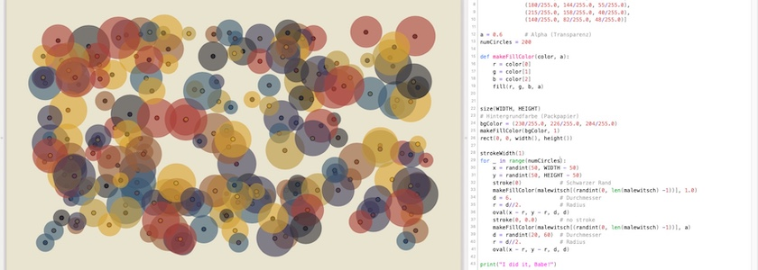
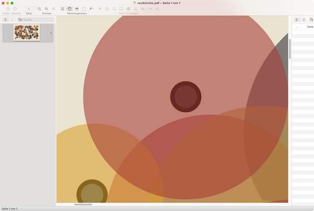

Alle Knotenschachteln -- egal ob [NodeBox&nbsp;1](http://cognitiones.kantel-chaos-team.de/programmierung/creativecoding/nodebox/nodebox.html), [PlotDevice](http://cognitiones.kantel-chaos-team.de/programmierung/creativecoding/nodebox/plotdevice.html), [NodeBox for OpenGL](http://cognitiones.kantel-chaos-team.de/programmierung/creativecoding/nodebox/nodeboxforopengl.html) oder [Shoebot](http://cognitiones.kantel-chaos-team.de/programmierung/creativecoding/shoebot.html) -- gehen auf eine Macintosh-App zurück: Auf [DrawBot](http://cognitiones.kantel-chaos-team.de/programmierung/creativecoding/drawbot.html).

**[DrawBot](https://www.drawbot.com/)** ist eine mächtige, freie (BSD-Lizenz), in Python geschriebene Anwendung für macOS für die Erstellung zweidimensionaler Graphiken. DrawBot kann, im Gegensatz zum Beispiel zu Processing, mehrere Seiten mit einem Skript erzeugen. DrawBots Exportformate sind PDF (auch via Menü), SVG, PNG, JPEG, TIFF, animated GIF, MP4-Video und noch einige mehr (via [`saveImage`](https://www.drawbot.com/content/canvas/saveImage.html)). Die Anwendung kommt als binäre, vollständige Applikation (erstellt mit py2app), sie kann aber auch als Modul in anderen Python-Anwendungen eingesetzt werden. Aber auch das Modul ist Mac-only, da mit PyObjC erstellt, und damit verwandt mit seinem Nachfolgerprojekt Nodebox&nbsp;1.

Einer der Hauptentwickler von DrawBot ist der Typograph *[Just van Rossum](https://de.wikipedia.org/wiki/Just_van_Rossum)*, ein Bruder des Python-»Erfinders« *[Guido van Rossum](https://de.wikipedia.org/wiki/Guido_van_Rossum)*[^1].

[^1]: Funfakt am Rande: Im Gegensatz zu seinem Bruder, der den `snake_case` zu einem Quasi-Standard für Python erhoben hat, bevorzugt *Just van Rossum* den `camelCase` und setzt das auch konsequent in DrawBot um.

Ich selber bin erst verhältnismäig spät (im August 2021) [über DrawBot gestolpert](http://blog.schockwellenreiter.de/2021/08/2021083001.html) und habe dann auch ein [paar Mal](http://blog.schockwellenreiter.de/2021/09/2021090501.html) damit [herumgespielt](http://blog.schockwellenreiter.de/2022/03/2022031402.html) und dabei über ein [Reboot nachgedacht](https://kantel.github.io/posts/2023110601_drawbot_reboot/). Grund dafür war auch hier, dass DrawBot auflösungsunabhängige Dateien ausgibt, die sich beliebig verlustfrei aufblasen lassen.

Das war natürlich ein Ansporn für mich, die zufälligen Kreise, die ich in den letzten Tagen mit [NodeBox&nbsp;1 und mit PlotDevice auflösungsunabhängig realisiert](https://kantel.github.io/posts/2026110601_plot_device/) hatte, auch mal nach DrawBot zu portieren. Das Ergebnis ist dasselbe (auch wenn ich dieses Mal -- um nicht immer gleich aussehende Screenshots zu haben -- als Hintergrundfarbe Packpapierbraun gewählt hatte). Doch hier erst einmal der Quellcode:

~~~python
from random import randint

WIDTH, HEIGHT = 640, 400
malewitsch = [(42/255.0, 40/255.0, 45/255.0),
              (160/255.0, 51/255.0, 46/255.0),
              (54/255.0, 50/255.0, 80/255.0),
              (50/255.0, 80/255.0, 105/255.0),
              (180/255.0, 144/255.0, 55/255.0),
              (215/255.0, 158/255.0, 40/255.0),
              (140/255.0, 82/255.0, 48/255.0)]
                        
a = 0.6       # Alpha (Transparenz)
numCircles = 200

def makeFillColor(color, a):
    r = color[0]
    g = color[1]
    b = color[2]
    fill(r, g, b, a)

size(WIDTH, HEIGHT)
# Hintergrundfarbe (Packpapier)
bgColor = (230/255.0, 226/255.0, 204/255.0)
makeFillColor(bgColor, 1)
rect(0, 0, width(), height())

strokeWidth(1)
for _ in range(numCircles):
    x = randint(50, WIDTH - 50)
    y = randint(50, HEIGHT - 50)
    stroke(0)            # Schwarzer Rand
    makeFillColor(malewitsch[(randint(0, len(malewitsch) -1))], 1.0)
    d = 6.               # Durchmesser
    r = d//2.            # Radius
    oval(x - r, y - r, d, d)
    stroke(0, 0.0)       # no stroke
    makeFillColor(malewitsch[(randint(0, len(malewitsch) -1))], a)
    d = randint(20, 60)  # Durchmesser
    r = d//2.            # Radius
    oval(x - r, y - r, d, d)

print("I did it, Babe!")
~~~

Bis auf Nuancen ist er wieder nahezu identisch mit den PlotDevice- und NodeBox-1-Beispielen[^2]. Ein Unterschied ist, dass DrawBox die RGB-Werte als Nachkommazahlen zwischen Null und Eins erwartet. Ein anderer, dass der Ursprung des Koordinatensystems bei DrawBot in der **linken unteren** Ecke liegt. Das musste aber in diesem Beispiel nur dabei beachtet werden, dass die Radii (da der Ursprung der `oval()`-Funktion in der **linken oberen** Ecke liegt und somit der dritte und vierte Parameter nicht die Radii, sondern der Durchmesser, genauer die Breite und die Höhe des Ovals, sind), von der x- **und** y-Koordinate abgezogen werden müssen, um die Kreise zentriert zu zeichnen.

[^2]: Die »neue« Funktion `makeFillColor()` (camelCase 🤓) ist vielleicht der Ausweg, wie ich RGB-Farbwerte auch in NodeBox&nbsp;1 und PlotDevice mit unterschiedlichen Alpha-Werten (für die Transparenz) kombinieren kann, ohne gleich ein zweites Array anlegen zu müssen.

Ein weiterer »Trick« ist auch, dass ich mit `stroke(0, 0.0)` den zweiten, äußeren Kreis ohne Umrandung gezeichnet habe. Denn eine voll transparente Umrandung ist keine Umrandung.

Auch das Spielen mit DrawBot hat mir viel Spaß gemacht. Jetzt weiß ich wirklich nicht, welche der drei Applikationen ich für mein mögliches Projekt »[Generative Art auf Papier und zwischen zwei Pappedeckel gepresst](http://blog.schockwellenreiter.de/2022/03/2022031101.html)« einsetzen soll. Ich werde mit allen drei wohl noch ein wenig spielen müssen, um mich entscheiden zu können. Aber da ich ja bekanntlich ein großes Spielkalb bin … *Still digging!*

