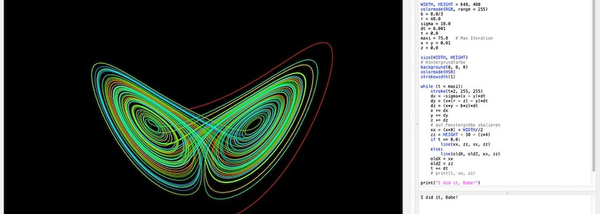
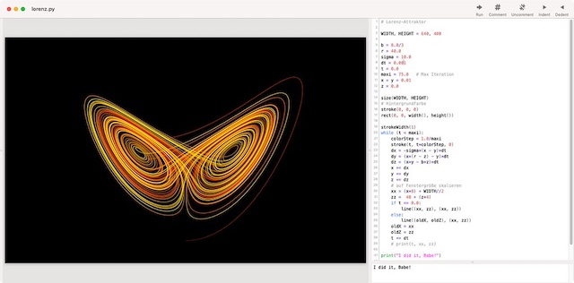

Als einer der ersten hatte *[Edward N. Lorenz](https://de.wikipedia.org/wiki/Edward_N._Lorenz)*, ein Meteorologe am [Massachusetts Institute of Technology](https://de.wikipedia.org/wiki/Massachusetts_Institute_of_Technology) (MIT), 1961 erkannt, dass Iteration Chaos erzeugen kann. Er benutzte dort einen Computer, um ein einfaches, nichtlineares Gleichungssystem zu lösen, das ein simples Modell der Luftströmungen in der Erdathmosphäre simulieren sollte. Dazu benutzte er ein System von sieben Differentialgleichungen, das *[Barry Saltzman](https://www.encyclopedia.com/science/dictionaries-thesauruses-pictures-and-press-releases/saltzman-barry)* im gleichen Jahr aus den [Navier-Stokes-Gleichungen](https://de.wikipedia.org/wiki/Navier-Stokes-Gleichungen) hergeleitet hatte. Für dieses System existierte keine analytische Lösung, also musste es numerisch (das hieß, wie damals und auch heute noch vielfach üblich, in FORTRAN) gelöst werden. Lorenz hatte entdeckt, dass bei nichtperiodischen Lösungen der Gleichungen vier der sieben Variablen gegen Null strebten. Daher konnte er das System auf drei Gleichungen reduzieren:

$$
\begin{align}
\frac{dx}{dt} & = \gamma x + yz \\
\frac{dy}{dt} & = \sigma (y - z) \\
\frac{dz}{dt} & = -xy + \rho y - z
\end{align}
$$

Dabei sind $\sigma=−10$, $\rho=28$ und $\gamma=−\frac{8}{3}$. Die Parameter der Gleichung habe ich *[Stew1993]* entnommen.

Nach ersten Läufen gab Lorenz die Anfangswerte nicht mehr sechstellig (das war damals der FORTRAN-Standard), sondern nur noch dreistellig ein, da er der Meinung war, dass eine Abweichung von unter einem Promille keine Bedeutung habe.

Dabei entdeckte er, dass diese Lösung nur noch in den Anfangsergebnissen mit der Lösung der sechsstelligen Eingabe übereinstimmte. Alle weiteren Werte liefen beträchtlich auseinander. Lorenz grundlegende Erkenntnis war, dass dieses Phänomen kein Computerfehler, sondern eine prinzipielle Eigenschaft nichtlinearer Gleichungssysteme sei. Schon die geringeste Änderung in den Anfangsbedingungen kann eine komplett andere Lösung hervorbringen. Diese Beobachtung ging später als »[Schmetterlingseffekt](https://de.wikipedia.org/wiki/Schmetterlingseffekt)« (»*Der Schlag eines Schmetterlingsflügels in Brasilien kann einen Tornado über Texas hervorrufen.*«) in die Geschichte der [Chaostheorie](https://de.wikipedia.org/wiki/Chaosforschung) ein.

Das Gleichungssystem, ein seltsamer Attraktor eines Systems von drei gekoppelten, nichtlinearen gewöhnlichen Differentialgleichungen, nach seinem Entdecker »[**Lorenz-Attraktor**](https://de.wikipedia.org/wiki/Lorenz-Attraktor)« genannt, wollte ich auch einmal mit der Knotenschachtel ([NodeBox&nbsp;1](http://cognitiones.kantel-chaos-team.de/programmierung/creativecoding/nodebox/nodebox.html)) visualisieren.

Da ich den Aufwand über NumPy/SciPy und die Funktion [`odeint`](https://docs.scipy.org/doc/scipy/reference/generated/scipy.integrate.odeint.html) scheute (obwohl das prinzpiell mit NodeBox&nbsp;1 möglich wäre), habe ich das einfache [Eulersche Poligonzugverfahren](https://de.wikipedia.org/wiki/Explizites_Euler-Verfahren) zur numerischen Berechnung benutzt:

~~~python
dx = -sigma*(x - y)*dt
    dy = (x*(r - z) - y)*dt
    dz = (x*y - b*z)*dt
    x += dx
    y += dy
    z += dz
~~~

Um der Kurve einen möglichst flüssigen Verlauf ohne Ecken und Kanten zu spendieren, habe ich `dt = 0.001` gesetzt. Das benötigt natürlich mehr Rechenkapazität, als sie Lorenz je zur Verfügung standen, aber trotz der größeren Genauigkeit ändert sich nichts am chaotischen Verhalten der Kurve. Für die Farbberechnung habe ich den `colormode(HSB)` gesetzt, aber nur den Farbwert *(Hue)* bei jeder Iteration geändert, Sättigung *(Saturation)* und Helligkeit *(Brightness)* bleiben konstant auf dem höchsten Wert. Das ergibt kräftige Farben, die von Rot über Orange nach Gelb und dann nach Grün, Blau und Violett wandern. So kann man schön erkennen, daß die beiden »Flügel« des Attraktors immer wieder, aber für uns unvorhersehbar, durchlaufen werden.

### Der Quellcode (NodeBox)

Hier nun der vollständige Quellcode des Skripts. Er ist kurz und selbsterklärend und folgt weitestgehend einem Pascal-Programm aus *[Herm1994]*, Seiten 80ff.:

~~~python
WIDTH, HEIGHT = 640, 400
colormode(RGB, range = 255)
b = 8.0/3
r = 40.0
sigma = 10.0
dt = 0.001
t = 0.0
maxi = 75.0   # Max Iteration
x = y = 0.01
z = 0.0

size(WIDTH, HEIGHT)
# Hintergrundfarbe
background(0, 0, 0)
colormode(HSB)
strokewidth(1)

while (t < maxi):
    stroke(t*2, 255, 255)
    dx = -sigma*(x - y)*dt
    dy = (x*(r - z) - y)*dt
    dz = (x*y - b*z)*dt
    x += dx
    y += dy
    z += dz
    # auf Fenstergröße skalieren
    xx = (x*8) + WIDTH//2
    zz = HEIGHT - 30 - (z*4)
    if t == 0.0:
        line(xx, zz, xx, zz)
    else:
        line(oldX, oldZ, xx, zz)    
    oldX = xx
    oldZ = zz
    t += dt
    
print("I did it, Babe!")
~~~

Der Output des Sketches zeigt die dreidimensionale Kurve projiziert auf die X- und Z-Ebene. Mit wenigen Änderungen könnt Ihr aber auch eine Projektion auf die X- und Y-Ebene oder auf die Y- und Z-Ebene bekommen.

### Der Quellcode (DrawBot)

Davon angefixt wollte ich dann noch wissen, wie einfach sich ein Port des Skript zur [DrawBot](http://cognitiones.kantel-chaos-team.de/programmierung/creativecoding/drawbot.html), der »[Mutter aller Knotenschachteln](https://kantel.github.io/posts/2026110702_drawbot/)«, durchführen ließ. Spoiler: Es waren nur wenige Änderungen nötig:

~~~python
WIDTH, HEIGHT = 640, 400

b = 8.0/3
r = 40.0
sigma = 10.0
dt = 0.001
t = 0.0
maxi = 75.0   # Max Iteration
x = y = 0.01
z = 0.0

size(WIDTH, HEIGHT)
# Hintergrundfarbe
stroke(0, 0, 0)
rect(0, 0, width(), height())

strokeWidth(1)
while (t < maxi):
    colorStep = 1.0/maxi
    stroke(t, t*colorStep, 0)
    dx = -sigma*(x - y)*dt
    dy = (x*(r - z) - y)*dt
    dz = (x*y - b*z)*dt
    x += dx
    y += dy
    z += dz
    # auf Fenstergröße skalieren
    xx = (x*8) + WIDTH//2
    zz =  40 + (z*4)
    if t == 0.0:
        line((xx, zz), (xx, zz))
    else:
        line((oldX, oldZ), (xx, zz))    
    oldX = xx
    oldZ = zz
    t += dt
    
print("I did it, Babe!")
~~~

Die einfachste Änderung war, dass DrawBot keine `background()`-Funktion besitzt, also musste ich stattdessen ein (schwarzes) Rechteck über den kompletten Canvas zeichnen.

Ebenfalls einfach war zu realisieren, dass sich in DrawBot die y-Achse umkehrt. Daher musste, statt wie in der NodeBox

~~~python
yAchse = HEIGHT - margin - skalierungsfaktor
~~~

in DrawBot

~~~python
yAchse = margin + skalierungsfaktor
~~~

gesetzt werden. Der Unterschied von zehn Pixeln in `margin` wurde von mir willkürlich aus ästhetischen Gründen gewählt.

Der größte Aufwand war, dass DrawBot keinen HSB/HSV-Farbraum kennt. Um mit RGB ebenfalls eine ansprechende Farbgebung zu erreichen, habe ich daher ebenfalls recht willkürlich eine Variable `colorStep` erzeugt, die in Abhängigkeit von `maxiter` und `t` ihren Wert ändert:

~~~python
    colorStep = 1.0/maxi
    stroke(t, t*colorStep, 0)
~~~

Und diese Variable ändert nun fortschreitend nur den Rot- und Grün-Anteil der RGB-Farbe, während der Blau-Anteil auf Null gesetzt bleibt, Das führt zu einer Rot-Orange-Gelb-Oszillaton der Farben, die doch auch recht nett aussieht.

### Literatur

- *[BeDö2025a]* Karl-Heinz Becker, Michael Dörfler: *Fraktale und Dynamische Systeme. Computergrafische Experimente mit Processing*, Bremen 2025, Seiten 85ff.
- *[BeDö2025b]* Karl-Heinz Becker, Michael Dörfler: *Fratale XXL - Bilderbuch der Fraktale. Computergrafische Experimente mit Processing*, Bremen 2025, Seiten 31ff.
- *[Chan2012]* Sau Sheong Chang: *Exploring Everyday Things with R and Ruby*, Sebastopol (O’Reilly) 2012
- *[Herm1994]* Dieter Hermann: *Algorithmen für Chaos und Fraktale*, Bonn (Addison-Wesley) 1994, Seiten 80ff.
- *[Pief1991]* Frank Piefke: *Simulationen mit dem Personalcomputer*, Heidelberg (Hüthig) 1991
- *[Soet2009]* Karline Soetaert, Peter M. J. Hermann: *A Practical Guide to Ecological Modelling: Using R as a Simulation Platform*, o.O. (Springer Netherlands) 2009
- *[Stew1993]* Ian Stewart: *Spielt Gott Roulette?*, Frankfurt (Insel TB) 1993
