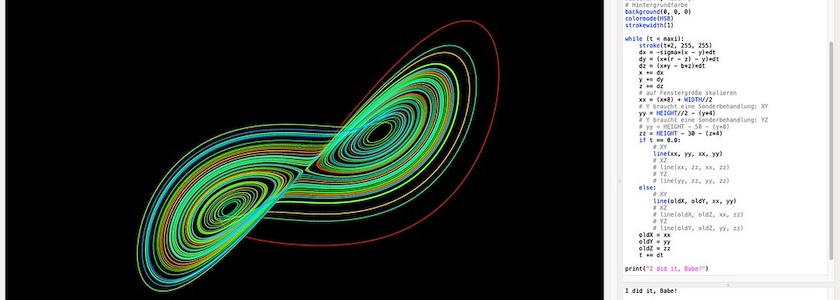
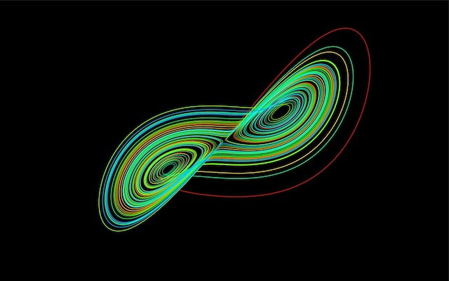
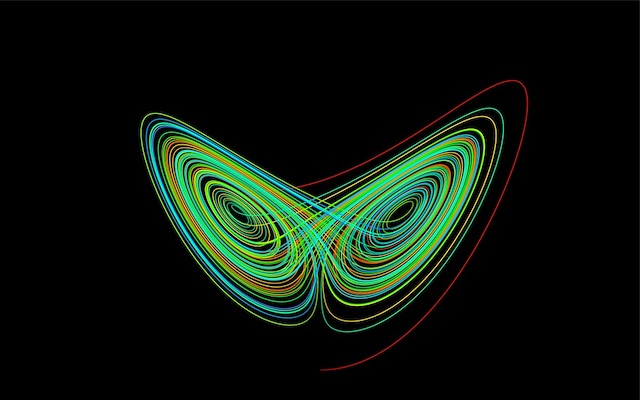
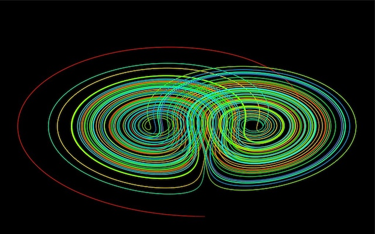
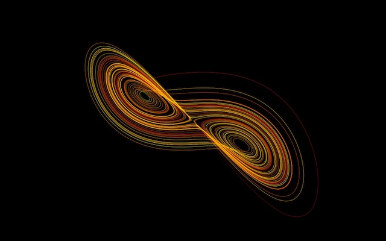
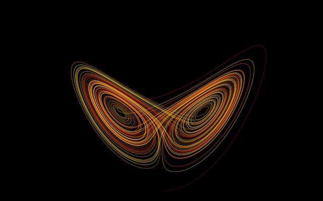
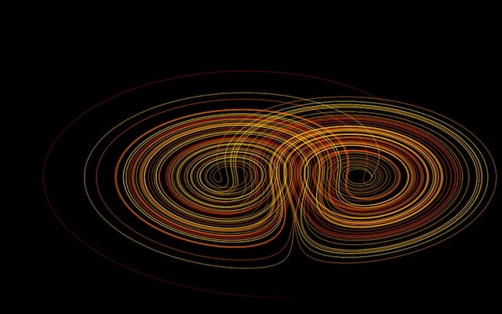

Im [letzten Beitrag](https://kantel.github.io/posts/2026110901_lorenz_attraktor/) hatte ich behauptet, dass es ein Leichtes sei, den Lorenz-Attraktor auf alle Ebenen des dreidimensionalen Raums, also aug die X-Y-Ebene, die X-Z-Ebene und die Y-Z-Ebene, zu projizieren. Hier ist mein Versuch, dies zu implementieren (und zwar einmal für die NodeBox und einmal für den DrawBot). Die Änderungen betreffen jeweils nur die `while()`-Schleife:

### X-Y-Ebene (NodeBox)

~~~python
while (t < maxi):
    stroke(t*2, 255, 255)
    dx = -sigma*(x - y)*dt
    dy = (x*(r - z) - y)*dt
    dz = (x*y - b*z)*dt
    x += dx
    y += dy
    z += dz
    # auf Fenstergröße skalieren
    xx = (x*8) + WIDTH//2
    # Y braucht eine Sonderbehandlung: XY
    yy = HEIGHT//2 - (y*4)
    if t == 0.0:
        line(xx, yy, xx, yy)
    else:
        line(oldX, oldY, xx, yy) 
    oldX = xx
    oldY = yy
    t += dt
~~~

### X-Z-Ebene (NodeBox)

~~~python
while (t < maxi):
    stroke(t*2, 255, 255)
    dx = -sigma*(x - y)*dt
    dy = (x*(r - z) - y)*dt
    dz = (x*y - b*z)*dt
    x += dx
    y += dy
    z += dz
    # auf Fenstergröße skalieren
    xx = (x*8) + WIDTH//2
    zz = HEIGHT - 30 - (z*4)
    if t == 0.0:
        line(xx, zz, xx, zz)
    else:
        line(oldX, oldZ, xx, zz)
    oldX = xx
    oldZ = zz
    t += dt
~~~

### Y-Z-Ebene (NodeBox)

~~~python
while (t < maxi):
    stroke(t*2, 255, 255)
    dx = -sigma*(x - y)*dt
    dy = (x*(r - z) - y)*dt
    dz = (x*y - b*z)*dt
    x += dx
    y += dy
    z += dz
    # auf Fenstergröße skalieren
    # Y braucht eine Sonderbehandlung: YZ
    yy = HEIGHT - 50 - (y*8) 
    zz = HEIGHT - 30 - (z*4)
    if t == 0.0:
        line(yy, zz, yy, zz)
    else:
        line(oldY, oldZ, yy, zz)   
    oldY = yy
    oldZ = zz
    t += dt
~~~

### X-Y-Ebene (DrawBot)

~~~python
while (t < maxi):
    colorStep = 1.0/maxi
    stroke(t, t*colorStep, 0)
    dx = -sigma*(x - y)*dt
    dy = (x*(r - z) - y)*dt
    dz = (x*y - b*z)*dt
    x += dx
    y += dy
    z += dz
    # auf Fenstergröße skalieren
    xx = (x*8) + WIDTH//2
    # Y braucht eine Sonderbehandlung: XY
    yy = HEIGHT//2 - (y*4)
    if t == 0.0:
        line((xx, yy), (xx, yy))
    else:
        line((oldX, oldY), (xx, yy)) 
    oldX = xx
    oldY = yy
    t += dt
~~~

### X-Z-Ebene (DrawBot)

~~~python
while (t < maxi):
    colorStep = 1.0/maxi
    stroke(t, t*colorStep, 0)
    dx = -sigma*(x - y)*dt
    dy = (x*(r - z) - y)*dt
    dz = (x*y - b*z)*dt
    x += dx
    y += dy
    z += dz
    # auf Fenstergröße skalieren
    xx = (x*8) + WIDTH//2
    zz =  40 + (z*4)
    if t == 0.0:
        line((xx, zz), (xx, zz))
    else:
        line((oldX, oldZ), (xx, zz))
    oldX = xx
    oldZ = zz
    t += dt
~~~

### Y-Z-Ebene (DrawBot)

~~~python
while (t < maxi):
    colorStep = 1.0/maxi
    stroke(t, t*colorStep, 0)
    dx = -sigma*(x - y)*dt
    dy = (x*(r - z) - y)*dt
    dz = (x*y - b*z)*dt
    x += dx
    y += dy
    z += dz
    # auf Fenstergröße skalieren
    # Y braucht eine Sonderbehandlung: YZ
    yy = HEIGHT - 50 - (y*8) 
    zz =  40 + (z*4)
    if t == 0.0:
        line((yy, zz), (yy, zz))
    else:
        line((oldY, oldZ), (yy, zz))      
    oldY = yy
    oldZ = zz
    t += dt
~~~

