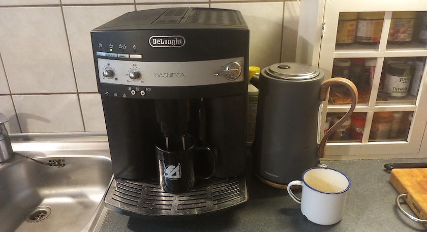

[Andere](https://wirres.net/) bringen doch auch immer Berichte über ihre neuesten Gadgets, warum nicht auch ich? Da der liebsten aller Freundinnen der von mir handgebrühte Filterkaffee immer zu stark war, hat sie bei mir diese (gebrauchte) Kaffeemaschine aufgestellt (sie hatte eine neue Maschine von ihren Kindern geschenkt bekommen): Becher mit in individueller Stärke gebrühten Kaffees auf Knopfdruck, in wenigen Sekunden fertig.

Der mathematische Kaffeebecher mit einer Veranschaulichung des Prinzips der [Hip(p)otenuse](https://de.wikipedia.org/wiki/Rechtwinkliges_Dreieck) war ein Geschenk meines leider viel zu früh verstorbenen Freundes, (Hochschul-) Lehrers und Kollegen *[Wolfgang Lefèvre](https://kantel.github.io/posts/2026011201_wolfgang_lefevre/)*.

---

**Photo** ([cc](https://creativecommons.org/licenses/by-sa/4.0/deed.de)) 2026: *[Jörg Kantel](http://cognitiones.kantel-chaos-team.de/cv.html)*