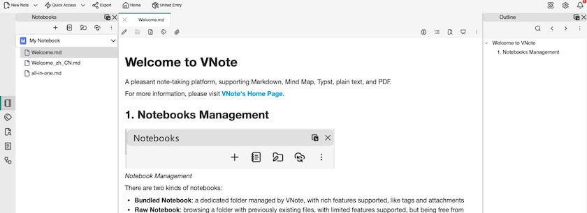

Seitdem die [Ankündigung](https://kantel.github.io/posts/2026091502_anytwo/) von [Anytype](https://anytype.io/) mir Angst macht, auf ein nicht rückwärtskompatibles Anytwo zu migrieren, bin ich ja auf der Suche nach Alternativen für meine digitale Rumpelkammer, die neben [Joplin](http://cognitiones.kantel-chaos-team.de/webworking/staticsites/joplin.html), als mein bewährter, digitaler Zettelkasten, die [Basis für mein zweites Gehirn](https://kantel.github.io/posts/2025112701_anytype_051/) bilden soll.

Nun ist mir [**VNote**](https://docs.vnote.fun/) untergekommen, eine kostenlose Open-Source-Notiz-App (LPGL-3.0) für Windows, Linux und macOS, die zwar auf der einen Seite vorgibt, »von Programmierern für Programmierer« entwickelt worden zu sein, doch mein erster Eindruck ist, dass man kein Programmierer sein muss, um diese App zu nutzen.

VNote ist in erster Linie ein Markdown-Editor. Er unterstützt Tabs und Arbeitsbereiche (ähnlich wie Tab-Gruppen), um die Organisation während der Arbeit zu erleichtern, und bietet Tags und verschachtelte Ordner, um meine Notizen zu ordnen. Wikilinks scheint VNote allerdings nicht zu unterstützen (das ist aber für meine digitale Rumpelkammer nicht so wichtig).

Neben Markdown werden noch eine Reihe andere Formate unterstützt, unter anderem [Typst](https://typst.app/), das ich [immer noch für eine rückwärtsgewandte Sackgasse](https://kantel.github.io/posts/2023091002_typst_1st_steps/) halte, normale Text- und Quellcode-Dateien, Mind Maps und PDFs.

Das Teil wird noch weiter gepflegt (die letzte Aktualisierung ist von gestern) und etwa fünfzig Menschen entwickeln an dem Teil mit. Mein einziges Bedenken ist, dass VNote sich zu wenig von Joplin unterscheidet, um als meine digitale Rumpelkammer fungieren zu können.

### Links

- [Anytpye Home](https://docs.vnote.fun/), gleichzeitig ausführliche Dokumentation
- [Anytype @ GitHub](https://github.com/vnotex/vnote)

Ich werde in der nächsten Zeit jedenfalls ein paar weitere Tests mit VNote fahren, um die Software abschließend beurteilen zu können. *Still digging!*