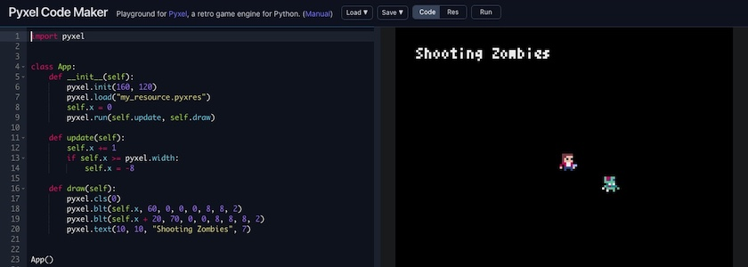
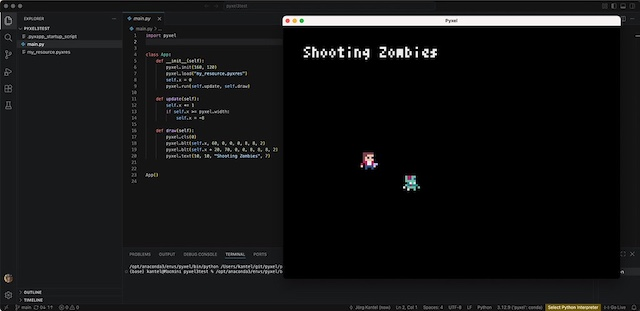

[Schon lange](https://kantel.github.io/posts/2026050102_retrogaming_pyxel/) hatte ich auf diesen Seiten nichts mehr über [Pyxel](http://cognitiones.kantel-chaos-team.de/multimedia/spieleprogrammierung/pyxel.html), der kleinen, von [TIC-80](http://cognitiones.kantel-chaos-team.de/multimedia/spieleprogrammierung/tic80.html) und Pico-8 inspirierten (Python3-) Retrogame-Engine und Fantasy-Konsole. Ich hatte das kleine Teil irgendwie aus den Augen verloren.

Doch über das Wochenende bin ich mehr oder weniger zufällig wieder darüber gestolpert und musste feststellen, dass Pyxel vor wenigen Wochen nicht nur in der Version 3.0 (aktuell [v3.0.2](https://github.com/kitao/pyxel/releases/tag/v3.0.2)) erschienen ist, sondern dass es mit dem [Pyxel Code Maker](https://kitao.dev/pyxel/code-maker/) nun auch die Möglicheit gibt, Pyxel-Spiele im Browser zu entwickeln.

Außerdem wurde nicht nur die [Pyxel Homepage](https://kitao.dev/pyxel/), sondern auch das [Pyxel Benutzerhandbuch](https://kitao.dev/pyxel/user-guide/) und das [Pyxel Editor Handbuch](https://kitao.dev/pyxel/editor-manual/) komplett überarbeitet und neben vielen anderen Sprachen auch ins Deutsche übersetzt.

Das musste ich natürlich sofort ausprobieren und habe das Update eingefahren. Jetzt läuft die Pyxel-IDE in ihrer eigenen, virtuellen Umgebung nicht nur auf meinem Desktop, sondern auch im Browser. Der Pyxel Code Maker funktioniert ganz ohne Anmeldung und scheint auch nichts auf seinem Server zu speichern, sondern gespeichert wird anscheinend nur im Browser-Cache. Das ist auf der einen Seite gut für die digitale Unabhängigkeit, auf der anderen Seite solltet Ihr aber eine regelmäßige und häufige Sicherung nicht vergessen.

Und ich habe aufgrund dieser erfreulichen Updates natürlich große Lust bekommen, meine eingeschlafene [Pyxel-Tutorial-Reihe](https://kantel.github.io/posts/2025051403_pyxel_tut_6/) wieder aufzunehmen. Schaun wir mal, was daraus wird. *Still digging!*