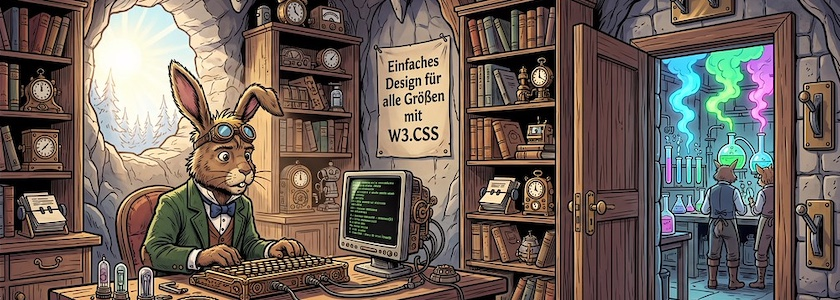

Meine [Versuche](https://kantel.github.io/posts/2026072901_back_to_the_roots/) mit dem IndieWeb auf Neocities, (statische) [Webseiten ohne Sinn und Verstand](http://blog.schockwellenreiter.de/2022/05/2022052401.html) zu basteln, leiden ja bisher unter einem großen Nachteil: [Die Seiten](https://kantel.neocities.org/) sind nicht responsiv und daher auf (m)einem Handy schwer zu lesen.

Daher habe ich mit großem Interesse den Artikel »[Stop Fighting CSS Layouts: Build Responsive Pages With 3 Classes](https://javascript.plainenglish.io/stop-fighting-css-layouts-build-responsive-pages-with-3-classes-3666559557e0)« (€) von *Er Raj Aryan* gelesen, der verspricht, dass man weder Bootstrap noch Grid oder eine 40-zeilige Media Query benötigt, um ein zweispaltiges Layout zu erstellen, das auf Mobilgeräten funktioniert. Er stellt darin **W3.CSS** vor, ein winziges CSS-Framework ohne JavaScript und ohne Einrichtungsaufwand, das verspricht, meine Layout-Probleme zu lösen.

Außerdem soll W3.CSS frei und Open Source sein und kann sowohl über das CDN der W3 Schools als auch lokal ([Download](https://www.w3schools.com/w3css/w3css_downloads.asp)) genutzt werden. Die aktuelle Version ist die Version 6.0.7 vom November dieses Jahres.

Das [W3.CSS Tutorial](https://www.w3schools.com/w3css/default.asp) auf den Seiten der W3 Schools lässt auch keine Wünsche offen und für das Framework spricht, dass es hinter dem Layout aller Seiten auf W3 Schools werkelt.

Also werde ich in den nächsten Tagen versuchen, meinen Neocities-Seiten damit ein responsives Layout zu verpassen. Ich habe also wieder zu tun. *Still digging!*

---

**Bild**: *[Der Märzhase in seinem IndieWeb-Labor](https://www.flickr.com/photos/schockwellenreiter/55658221814/)*, erstellt mit OpenArt. Prompt: »*The @March Hare sits at his desk inside a cavern, looking bewildered. He wears a pair of aviator goggles pushed up onto his forehead. In front of him stands an old-fashioned, steampunk-style computer with a large keyboard. In the background, shelves line the wall, filled with books, files, and various steampunk trinkets. Between the shelves hangs a poster that reads, "Einfaches Design für alle Größen mit W3.CSS". The winter sun shines through a large opening in the cavern wall that serves as a window. Toward the back right, the entrance to a laboratory is visible, featuring test tubes from which neon-colored vapor billows, along with massive, antique-looking switches mounted on the walls. Colored Franco-Belgian comic style. Language: German. No speech bubbles, no text boxes, no headlines.*« Modell: Nano Banana&nbsp;2.