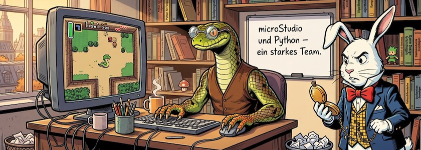
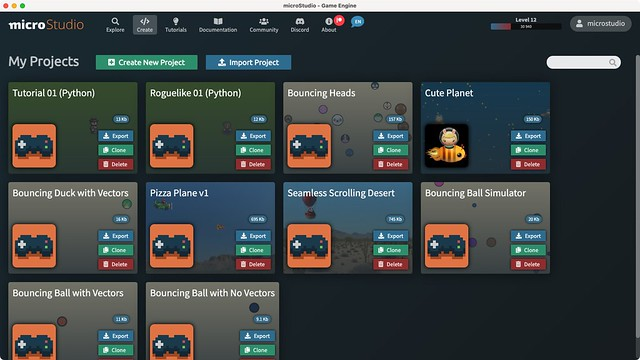
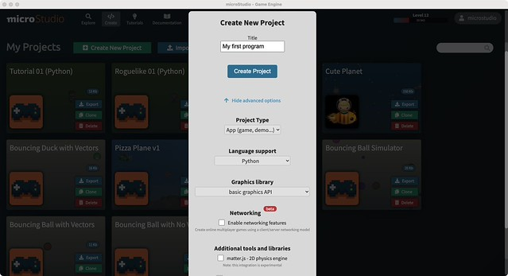
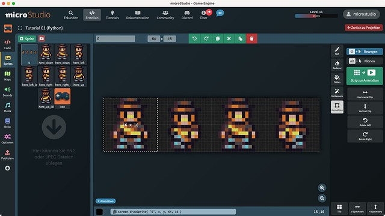
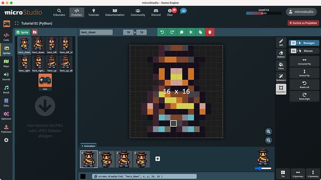
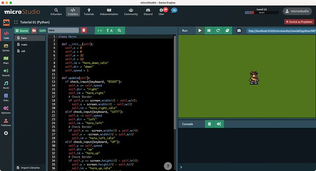

Da ich meine bisherigen Tutorials zu [microStudio und Python](https://kantel.github.io/#category=microStudio) auf eine solide Grundlage stellen möchte, habe ich einen kompletten Neustart der Reihe begonnen, die hoffentlich etwas ausführlicher und verständlicher werden wird.

### Was ist microStudio?

[**microStudio**](http://cognitiones.kantel-chaos-team.de/multimedia/spieleprogrammierung/microstudio.html) ist eine freie (MIT-Lizenz) 2D Game Engine, in der Spiele sowohl online im Browser als auch als Desktop-App für Windows, macOS, Linux und auf dem Raspberry Pi entwickelt werden können. Programmiert werden die Spiele per Default in microScript , einer einfachen von Lua inspirierten Sprache. Sie können aber auch in JavaScript, Python oder Lua programmiert werden.

microStudio enthält auch einen integrierten Sprite-, Karten- und Sound-/Musik-Editor und wirkt daher wie eine auf modern getrimmte Fantasiekonsole wie Pico-8 oder [TIC-80](http://cognitiones.kantel-chaos-team.de/multimedia/spieleprogrammierung/tic80.html), nur ohne deren konzeptionellen, nostalgischen Beschränkungen.

Mit microStudio erstellte Spiele können mit einem einzigen Klick aus der IDE heraus nach HTML5, Windows, Linux und macOS exportiert werden.

Es gibt drei verschiedene Möglichkeiten, mit microStudio Spiele zu entwickeln:

1. Im Browser: Ihr könnt Euch auf den [Seiten von microStudio](https://microstudio.dev/) ein Konto enrichten und dann sofort loslegen. Ich weiß nicht genau, wo der Server steht, aber da die Firma in Frankreich, genauer in Straßburg, sitzt, vermute ich, dass deren Server ebenfalls in Frankreich stehen. Die [Datenschutzseite](https://microstudio.dev/about/) verspricht jedenfalls, dass weder Nutzerdaten gesammelt noch weitergereicht werden.

2. Auf einen [eigenen Server](https://github.com/pmgl/microstudio#set-up-your-own-microstudio-server): Wer auf Nummer Sicher gehen will kann aber auch -- da die Software Open Source ist -- die Software auf einem eigenen Server betreiben (interessant vor allem für Schulen, Universitäten und anderen Bildungseinrichtungen). Dafür muss Node&nbsp;JS auf diesem Server installiert sein und dann microStudio und das microStudio-Wiki von der [GitHub-Seite](https://github.com/pmgl/microstudio) geladen werden. Wer die Programmierung mit Python/Brython plant, kann dies auch als Default-Projektsprache einstellen, und muss den Pfad zu der lokalen Brython-Bibliothek setzen. Die oben verlinkte GitHub-Seite besitzt eine ausführliche Anleitung.

3. Lokal auf dem Desktop: Wer lokal auf seinem Desktop mit microStudio entwickeln will, kann sich entweder von den [Release-Seiten](https://github.com/pmgl/microstudio/releases/tag/24.01.29) oder von den [microStudio-Seiten auf Itch.io](https://microstudio.itch.io/microstudio) die aktuelle Version für sein Betriebssystem herunterladen.

Da die Desktop-Version eine Elektron-App ist, ist sie zwar einerseits ziemich fett (auf meinem Mac belegt sie 365 MB), aber dafür ist auf der anderen Seite die Bedienung bei den Server-, wie auch bei den Desktop-Versionen identisch.

### Was ist Brython?

[**Brython**](http://cognitiones.kantel-chaos-team.de/programmierung/python/brython.html) (**Br**owser P**ython**) ist die Engine, die hinter der [Python-Version von microScript](https://microstudio.dev/documentation/Python/) werkelt. Es ist eine freie (BSD-3 Lizenz) Python-3-Implementierung, die im Browser läuft und als Ersatz für JavaScript gedacht ist. Neben der Standardbibliothek können auch andere (Pure Python) Module geladen werden, allerdings keine Module, die zum Beispiel C-basierte Teile enthalten. Das schließt Module wie Numpy, SciPy, Matplotlib oder Pandas aus. Dafür kann man in microStudio oft ähnliche, JavaScript-basierte Bibliotheken einsetzen[^1].

[^1]: Allerdings scheint die Integration von JavaScript in microStudio-Python/Bryton-Projekte nicht immer ganz schmerzfrei zu verlaufen. Hier ist neben dem (immer empfohlenen) [Blick in die Dokumentation](https://microstudio.dev/documentation/Advanced-microScript/) auch viel Experimentierfreude angesagt.

In Brython gibt die Keyboard-Abfrage unter Umständen beim ersten Aufruf ein undefined zurück. Um den Fehler zu umgehen, wird der Einsatz dieser Helper-Funktion

~~~python
def check_input(obj, val):
  if hasattr(obj, val):
    return obj[val] != 0
  return 0
~~~

empfohlen. Außerdem gibt es noch ein »eingebautes« Modul Browser, das den Python-Skripten Zugriffe auf das DOM-API erlaubt.

Brython ist als kompletter JavaScript-Ersatz konzipiert, kann also auch JavaScript-Objekte nutzen. Die Geschwindigkeit soll an die von CPython heranreichen. Brython wird aktuell (Stand November 2026) von 114 Kontributoren weiterentwickelt.

Um Python in microStudio zu benutzen, muss man dies beim Erstellen eines Projekts (unter `Advanced -> Language Support`) einrichten.

Ob man microStudio mit Python/Brython nutzen soll, ist sicher eine Frage der persönlichen Vorlieben. Ich zum Beispiel programmiere lieber in Python als in Lua oder JavaScript, daher war mir die Entscheidung für Python nach einer kurzen Experimentierphase mit microScript (der Default-Sprache von microStudio) leichtgefallen.

### Ein erstes microStudio/Python-Programm

Hier ist also ein erstes microStudio/Python-Programm, das zeigt, wie man einen kleinen, animierten Ingenieur in allen vier Himmelsrichtungen über den Bildschirm schickt (er wird entweder mit den Pfeiltasten oder mit den Tasten `w`, `a`, `s`, `d` gesteuert):

<iframe src="tutorial01python/" class="if16_9" name="Tiny Engineer v0.1"></iframe>

*Damit die Tastatursteuerung gelingt, müsst Ihr einmal in das Spielfeld klicken, damit es den Fokus erhält.*

Für den kleinen, animierten Ingenieur habe ich je vier Idle-Sprites und je vier Streifen mit jeweils vier Animationen benötigt, die ich [wieder](https://kantel.github.io/posts/2024030901_jumping_engineer/) dem freien ([CC-BY 4.0](https://creativecommons.org/licenses/by/4.0/)) Tileset [DawnLike](https://opengameart.org/content/dawnlike-16x16-universal-rogue-like-tileset-v181) von *DragonDePlatino* und *DawnBringer* entnommen habe. Damit sie in microStudio funktionieren, habe ich die Animationen mit einer darauf spezialisierten, freien (MIT-Lizenz) [Bildverarbeitung meines Vertrauens](https://github.com/odrick/free-tex-packer) ([Download](https://github.com/odrick/free-tex-packer/releases/tag/v0.6.7)) in vier einzelne Streifen für jede Richtung (`left`, `right`, `up` und `down`) und vier Einzelbilder für das `idle`-Sprite zerlegt und diese Streifen, respektive Bilder dann in microStudio importiert.

Dort habe ich dann im Sprite-Editor das erste Teilbild mit dem Auswahlwerkzeug markiert und dann mit dem darauf erscheinenden Button `Strip zur Animation` die Animation erstellt. Wichtig ist, daß die Größe des Streifens korrekt angegeben wird (in meinem Fall 4 mal 16 Pixel breit und 16 Pixel hoch, also 64 x 16 Pixel), sonst erscheinen die Bilder ziemlich gequetscht.

Dann habe ich noch in dem darauf angezeigten Schieberegler rechts unten die Animationsgeschwindigekeit auf `8 FPS` eingestellt. Das war es dann schon. Denn wenn man nun im Code-Editor in der Funktion `draw()` zum Beispiel die Zeile

~~~python
screen.drawSprite("hero_left", hero.x, hero.y, hero.w, hero.h)
~~~

eingibt, zeigt microStudio den komplette Animationszyklus an, ohne daß man ihn zusätzlich programmieren muß.

### Der Quellcode

Zuerst habe ich für den Helden (den Ingenieur, denn sind Ingenieure nicht alle Helden?) die Klasse `Hero` eingerichtet[^2]:

[^2]: Ich habe die Größe des Sprites verdoppelt (`self.w` und `self.h` auf 32 Pixel gesetzt, statt der 16 Pixel, die die Sprites eigentlich groß sind), damit der Held nicht so winzig über den Bildschirm wuselt. microStudio bewältigt Vergrößerungen von Sprites um einen ganzzahligen Faktor ziemlich gut.

~~~python
class Hero:
  
  def __init__(self):
    self.x = 0
    self.y = 0
    self.w = 32
    self.h = 32
    self.im = "hero_down_idle"
    self.dir = "down"
    self.speed = 1
    
  def update(self):
    if check_input(keyboard, "RIGHT"):
      self.x += self.speed
      self.dir = "right"
      self.im = "hero_right"
      # Check Border
      if self.x >= screen.width//2 - self.w//2:
        self.x = screen.width//2 - self.w//2
        self.im = "hero_right_idle"
    elif check_input(keyboard, "LEFT"):
      self.x -= self.speed
      self.dir = "left"
      self.im = "hero_left"
      # Check Border
      if self.x <= -screen.width//2 + self.w//2:
        self.x = -screen.width//2 + self.w//2
        self.im = "hero_left_idle"
    elif check_input(keyboard, "UP"):
      self.y += self.speed
      self.dir = "up"
      self.im = "hero_up"
      # Check Border
      if self.y >= screen.height//2 - self.h//2:
        self.y = screen.height//2 - self.h//2
        self.im = "hero_up_idle"
    elif check_input(keyboard, "DOWN"):
      self.y -= self.speed
      self.dir = "down"
      self.im = "hero_down"
      # Check Border
      if self.y <= -screen.height//2 + self.h//2:
        self.y = -screen.height//2 + self.h//2
        self.im = "hero_down_idle"
    else:    # the hero stands still (no key pressed)
      if self.dir == "right": self.im = "hero_right_idle"
      if self.dir == "left": self.im = "hero_left_idle"
      if self.dir == "up": self.im = "hero_up_idle"
      if self.dir == "down": self.im = "hero_down_idle"

  def draw(self):
    screen.drawSprite(self.im, self.x, self.y, self.w, self.h)
~~~

Den Löwenanteil des Codes nimmt die Ränderabfrage ein: Erreicht oder überschreitet unser Held den Bildschirmrand, wird er zuerst auf den Bildschirmrand zurückgesetzt (wichtig, wenn `self.speed > 1` ist) und erst dann das `idle`-Sprite geladen.

Wird jedoch die Taste einfach nur losgelassen, ohne dass der Held mit den Rändern kollidiert (also im `else`-Teil), dann wird der Held in Abängigkeit seiner aktuellen Richtung einfach nur auf `idle` gesetzt.

Die `draw()`-Methode ist sehr kompakt geraten, da wie oben erwähnt, microStudio die Sprite-Animation selber intern behandelt.

Das Hauptprogramm `main` ist ebenfalls sehr kurz, da die ganze Arbeit in der Klasse `Hero` erledigt wird:

~~~python
# microStudio (Python): Tutorial 1

def init():
  global hero
  hero = Hero()

def update():
  hero.update()
  if check_input(keyboard.press, "ESCAPE"):
    print("RESTART")
    init()

def draw():
  screen.clear("rgb(89, 127, 30")
  hero.draw()
~~~

microStudio besitzt, ähnlich wie [Processing (Java)](http://cognitiones.kantel-chaos-team.de/programmierung/creativecoding/processing/processing.html) oder [P5.js](http://cognitiones.kantel-chaos-team.de/programmierung/creativecoding/processing/p5js.html) drei Hauptfunktionen: `init()`, `update()` und `draw()`.

Die `init()`-Funktion wird nur einmal beim Start des Programms aufgerufen. Sie ist vor allem nützlich, um den Anfangszustand von globalen Variablen zu definieren, die im restlichen Programm verwendet werden können.

Die Funktion `update()` wird maximal 60 Mal pro Sekunde aufgerufen. Diese Funktion ist der beste Ort, um die Logik und Physik des Spiels zu programmieren.

Die Funktion `draw()` wird so oft aufgerufen, wie der Bildschirm aufgefrischt werden kann.

In den meisten Fällen wird auch `draw()` 60 mal pro Sekunde aufgerufen. Aber manche Computer oder Tablets können ihre Bildschirme mehr als 60 Mal pro Sekunde aktualisieren. Es kann auch vorkommen, dass das Gerät, auf dem das Programm läuft, überlastet ist und den Bildschirm nicht 60 Mal pro Sekunde auffrischen kann. In diesem Fall wird die Funktion `draw()` seltener aufgerufen. Das ist der Grund, warum `update()` und `draw()` zwei getrennte Funktionen sind: Egal was passiert, `update()` wird nach Möglichkeit genau 60 Mal pro Sekunde aufgerufen (aber nicht öfter); und wenn `draw()` aufgerufen wird, ist es Zeit, den Bildschirm neu zu zeichnen.

Das einzig Auffällige bei diesem kleinen Skript steht in der `update()`-Funktion: Wenn der Nutzer die Escape-Taste drückt, startet das Programm neu.

Dann habe ich auch noch die `util`-Datei. Hier stehen Hilfsroutinen, die nicht direkt in das eigentlich Skript gehören. Im Moment steht hier nur die ganz oben erwähnte Hilfsroutine zur Tastaturabfrage:

~~~python
def check_input(obj, val):
  if hasattr(obj, val):
    return obj[val] != 0
  return 0
~~~

Ich habe dieses Progrämmchen auf meinen microStudio-Account hochgeladen und unter dem Namen »[Tutorial 01 (Python)](https://microstudio.dev/i/kantel/tutorial01python/)« auf »öffentlich« gesetzt. Ihr könnt es von dort klonen, herunterladen und/oder damit herumspielen. Habt Spaß!

---

**Bild**: *[microStudio und Python – ein starkes Team](https://www.flickr.com/photos/schockwellenreiter/55660500446/)*, erstellt mit [OpenArt](https://openart.ai/home). Prompt: »*@Pedro Python sits at a desk in front of a computer with a massive monitor. He is typing away on the keyboard with his left hand while operating the mouse with his right. Next to the keyboard, there is a mug of steaming coffee, along with another mug filled with writing utensils. On the monitor, a retro-style game—reminiscent of 1990s \*Zelda\* titles—is visible. Beside him, @Rudi Rabbit stands, looking impatiently at a large pocket watch he holds in his hand. In the background, shelves are lined with computer science books—specifically on game programming and Python—with a few game figurines scattered among them. Between the shelves stands a whiteboard bearing the words: "microStudio und Python –  ein starkes Team." The room has a cluttered, untidy feel; an overflowing wastebasket sits next to the desk. Through a window on the left, the autumn sun shines in, revealing the rooftops of a large city. Colored Franco-Belgian comic style. Language: German. No speech bubbles, no text boxes, no headlines.*« Modell: Nano Banana&nbsp;2.