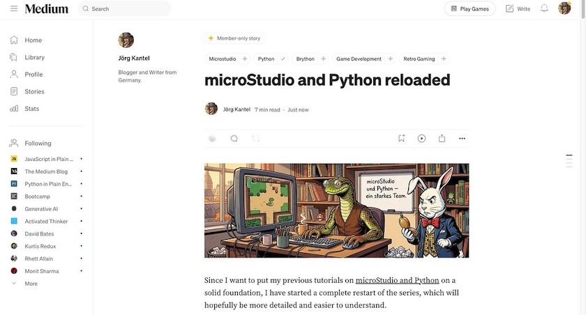

Nachdem ich jahrelang nur zahlendes (lesendes) Mitglied auf [Medium.com](https://de.wikipedia.org/wiki/Medium_(Website)) war, habe ich heute ein Experiment gestartet: Ich habe meinen Beitrag »[microStudio und Python reloaded](https://kantel.github.io/posts/2026111801_microstudio_python/)« von gestern ins englische übersetzt (genauer: von Google Translate ins englische übersetzen lassen) und auf [**Medium.com veröffentlicht**](https://medium.com/@joerg.kantel/microstudio-and-python-reloaded-7afee4d92179).

Es ist dort eine »Member-only story«, das heißt, Ihr müsst ebenfalls zahlendes Mitglied auf Medium sein, um den Beitrag auf (d)englisch lesen zu können.

Die Übersetzung verlief stressfreier, als ich dachte, ich musste eigentlich nur an wenigen Stellen Hand anlegen, an einigen aber massiv. Dennoch, im Großen und Ganzen scheint der automatische Übersetzer von Google recht zuverlässig zu arbeiten. Allerdings sind meine Englischkenntnisse ziemlich beschränkt, viele Fehler habe ich vermutlich nicht bemerkt.

Das ganze ist -- wie gesagt -- ein Experiment. Ich will die Reaktionen abwarten und dann darüber entscheiden, ob ich diesen Versuch fortführe (er ist doch recht aufwendig). *Still digging!*
