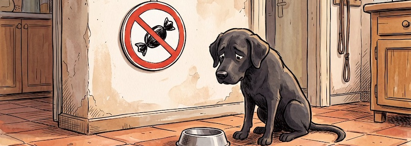

Ich hätte ja auch gerne einmal [BonBon](https://github.com/scripting/bonBon), *Dave Winers* neues [Spielzeug](http://scripting.com/2026/11/18/140257.html?title=gettingStartedWithBonbon), getestet. Doch leider spielt die Software nicht mit meinem Intel-Mac-Mini aus dem Jahre 2018, obwohl auf der Kiste mit macOS Sequoia ein noch offiziell von Apple unterstütztes Betriebssystem läuft.

Das passiert halt, wenn man sich blind auf eine gekünstelte Intelligenzia verlässt. So wird das nichts mit der World-Markdown.

---

**Bild**: *[Kein Bonbon](https://www.flickr.com/photos/schockwellenreiter/55669200798/)*, erstellt mit [Scenario](http://cognitiones.kantel-chaos-team.de/technikgeschichte/rechnerundnetze/scenario.html). Prompt: »*A black Labrador sits sadly in front of an empty food bowl. Above it hangs a sign featuring a black candy on a white background, set inside a red circle with a line through it. Franco-Belgian comic book style. No speech bubbles, no text boxes, and no headings.*« Modell: Nano Banana&nbsp;2.1.