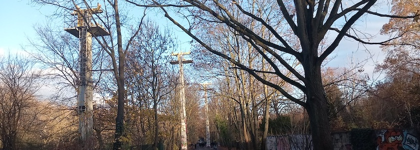
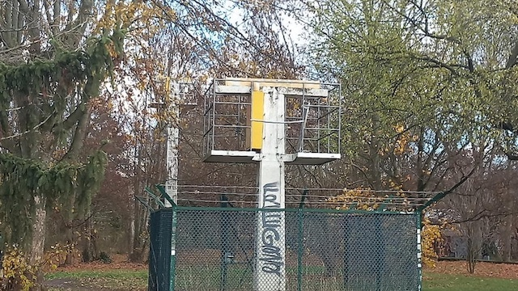

Besucht man den [Anita-Berger-Park](https://de.wikipedia.org/wiki/Anita-Berber-Park), ein ehemaliges Friedhofsgelände zwischen der Neuköllner Hermannstraße und dem Tempelhofer Feld, dann stechen einem die hohen Betonpfeiler mit den Plattformen sofort ins Auge. Sie gehörten zur Anflugbefeuerung des ehemaligen Flughafens Tempelhof und wurden in der Verlängerung der südlichen Start- und Landebahn jeweils in östlicher und westlicher Achse außerhalb des Flugfeldes errichtet.

Die erste Befeuerung der östlichen Einflugschneise erfolgt über zwei Reihen aus Stahlmasten auf den Kirchhöfen der St. Thomas- und der Jerusalem-Gemeinde. 1962 ließ die U.S. Air Force sie grundlegend erneuern.

Nahe dem Flugfeld waren die Masten niedrig und wurden mit zunehmender Entfernung immer höher. Zwei der östlichsten Signalfeuer befinden sich sogar auf den Dächern von Wohngebäuden an der Hermannstraße.

Mit der Stilllegung des Flughafens wurden die Signalfeuer der Leuchtfeueranlage abgestellt. Die stillgelegten Masten gehören heute zu dem bezirksübergreifenden Denkmalensemble Flughafen Tempelhof und Platz der Luftbrücke.

### Literatur und Quellen:

- Bezirksamt Neukölln von Berlin: *[Juli 2024: Neuköllns Denkmal des Monats](https://www.berlin.de/ba-neukoelln/politik-und-verwaltung/aemter/stadtentwicklungsamt/denkmalschutz/artikel.1467827.php)*, Berlin.de, besucht am 23.&nbsp;November&nbsp;2026
- Bezirksamt Neukölln von Berlin: *[Unser Denkmal des Monats: Die Leuchtfeuermasten des ehemaligen Flughafens Tempelhof](https://www.facebook.com/BANeukoellnBerlin/posts/unser-denkmal-des-monats-die-leuchtfeuermasten-des-ehemaligen-flughafens-tempelh/897336522440855/)*, Facebook Beitrag vom 18.&nbsp;Juli&nbsp;2024
- Industriekultur Berlin: *[Befeuerung der Einflugschneise](https://industriekultur.berlin/ort/befeuerung/). Orientierung für sicheres Landen*, Berliner Zentrum Industriekultur, besucht am 23.&nbsp;November&nbsp;2026
- Wikipedia: *[Anita-Berber-Park](https://de.wikipedia.org/wiki/Anita-Berber-Park)*, besucht am 23.&nbsp;November&nbsp;2026

---

**Photos** ([cc](https://creativecommons.org/licenses/by-sa/4.0/deed.de)) 2026: *[Jörg Kantel](http://cognitiones.kantel-chaos-team.de/cv.html)*