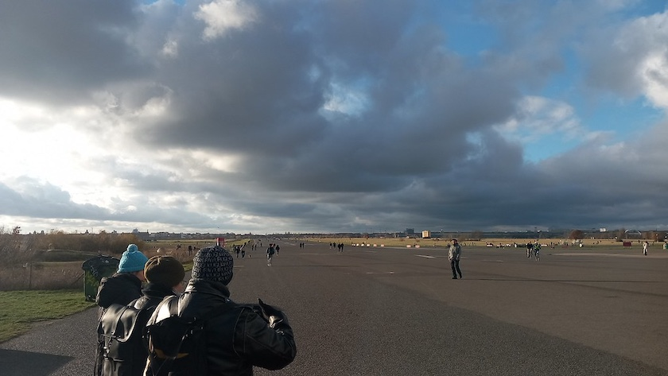

Natürlich mussten die liebste aller Freundinnen und ich, wenn wir [gestern schon im Anita-Berber-Park waren](https://kantel.github.io/posts/2026112202_leuchtfeuermasten/), auch einen Abstecher auf das Tempelhofer Feld wagen und konnten dort neben einem eiskalten Wind und der Weite des Feldes auch einen wunderbaren Himmel erleben.

---

**Photo** ([cc](https://creativecommons.org/licenses/by-sa/4.0/deed.de)) 2026: *[Jörg Kantel](http://cognitiones.kantel-chaos-team.de/cv.html)*