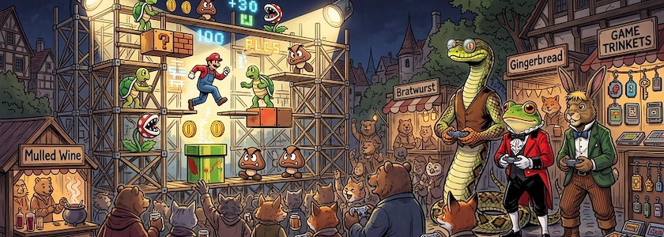

Während eines ziellosen Ausflugs durch die schier unendlichen Weiten des Webs spülte mir unser aller Datenkrake die deutschsprachige Playlist »[Pygame CE Tutorial Deutsch: Spiele programmieren mit Python](https://www.youtube.com/playlist?list=PLfvtEX0QsVj8)« des Kanals mit dem schönen Kampfnamen *Binärverkehr* in meinen Feedreader. Diese Reihe ist brandneu und besteht zur Zeit aus 26 Videos (das letzte Update ist gerade einmal 21 Stunden alt, also sind eventuell noch weitere Folgen zu erwarten).

<iframe class="if16_9" src="https://www.youtube.com/embed/rFTM1wEQ7d8?si=m1qz3pNZcJAXY5ms" title="YouTube video player" frameborder="0" allow="accelerometer; autoplay; clipboard-write; encrypted-media; gyroscope; picture-in-picture; web-share" referrerpolicy="strict-origin-when-cross-origin" allowfullscreen></iframe>

Was mich wirklich gefreut hat: Im ersten Video dieser Reihe wird der *Schockwellenreiter* zitiert (ab 10:28), und zwar mit diesem Beitrag: »[Retrogaming und KI: Pygame-CE statt Pygame?](https://kantel.github.io/posts/2024081502_pygame_ce/)« Und auch sonst scheint die Reihe zwar ein wenig langatmig, aber ganz hilfreich und gut gemacht zu sein (ich habe allerdings bisher mir nur die ersteh zehn Filmchen reinziehen können), auch wenn die in jedem Film laufende, ziemlich lange Sponsorenwerbung ein wenig nervt (aber spätestens nach dem dritten Video überspringt man sie sowieso).

Ich habe jedenfalls etliche Anregungen für meine eigenen, geplanten [microStudio mit Python/Brython Tutorials](https://kantel.github.io/posts/2026111801_microstudio_python/) bekommen.

In diesem Zusammenhang bin ich dann auch über den Beitrag »[Python Games in the Browser with pygame-ce, PyScript, and itch.io](https://medium.com/@davesides3/python-games-in-the-browser-with-pygame-ce-pyscript-and-itch-io-5e730185dbff)« von *David Sides* gestolpert, in dem er zeigt, wie man Pygame-CE-Spiele **ohne** [Pygbag](https://kantel.github.io/posts/2023060501_pygame_im_browser/) für den Browser veröffentlichen kann. Denn seit einiger Zeit hat PyScript einen (wenn auch noch experimentellen) [Pygame-(CE-) Support](https://docs.pyscript.net/2026.7.3/user-guide/pygame-ce/).

Momentan werde ich damit noch nichts anfangen, da ich erst meine microScript-Reihe abschließen will, aber für eine spätere Verwendung möchte ich hier vorab schon einmal ein paar Links festhalten:

- [Die Pygame-CE Website](https://pyga.me/)
- Die komplett überarbeitete [Pygame-CE Dokumentation](https://pyga.me/docs/)
- [Pygame-CE @ GitHub](https://github.com/pygame-community/pygame-ce) (letztes Update vor zwei Wochen, letztes [Release (2.5.8)](https://github.com/pygame-community/pygame-ce/releases/tag/2.5.8) vor drei Monaten)

*Still digging!*

---

**Bild**: *[Mario im Wunderland](https://www.flickr.com/photos/schockwellenreiter/55664377706/)*, erstellt mit [OpenArt](https://openart.ai/home). Prompt: »*@Pedro Python , @Fritz Frosch , and @March Hare stand before a large scaffolding structure, upon which a Mario-style platform game is being played by real-life performers—featuring one Mario-like character alongside many others. The trio stands facing the structure, watching the action intently; they hold gamepads in their hands, attempting to influence the course of the game. The scaffolding is positioned on the left, while @Pedro Python , @Fritz Frosch , and @March Hare are on the right. They are surrounded by a crowd of other anthropomorphic animals—some also clutching gamepads, others enjoying drinks. Stalls are set up all around, selling mulled wine, bratwurst, gingerbread, and various gaming-related trinkets. It is nighttime; the scaffolding is illuminated by large spotlights, while the stalls are lit only with a subtle, understated glow. Colored Franco-Belgian comic style. No speech bubbles, no text boxes, no headlines.*« Modell: Nano Banana&nbsp;2.