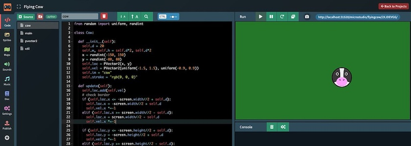

Es wird Zeit, dass ich meinen [Neustart](https://kantel.github.io/posts/2026111801_microstudio_python/) der Reihe »microStudio und Python« fortsetze, Hierfür möchte ich heute nur ein kleines Progrämmchen vorstellen, in dem eine Kuh über den Bildschirm schwebt (denn in meiner Welt können auch Kühe fliegen). Das ist -- außer der Tatsache der fliegenden Kuh -- nichts besonderes, bis auf dass ich die Klasse `PVector2` vorstelle und verwende.

Diese [2D-Vector-Klasse](http://blog.schockwellenreiter.de/2018/11/2018112301.html) hatte ich -- angelehnt an [Processings PVector-Klasse](https://www.processing.org/reference/PVector.html) -- vor Jahren einmal in Pure-Python [implementiert](http://blog.schockwellenreiter.de/2018/11/2018111902.html) und bisher erfolgreich sowohl in der [Nodebox](http://cognitiones.kantel-chaos-team.de/programmierung/creativecoding/nodebox/nodebox.html) (dafür hatte ich sie ursprünglich geschrieben) wie auch in der [Arcade-Bibliothek](http://cognitiones.kantel-chaos-team.de/multimedia/spieleprogrammierung/arcade.html), (hier ein [Beispiel](http://blog.schockwellenreiter.de/2020/06/2020062801.html)), in [TigerJython](http://cognitiones.kantel-chaos-team.de/programmierung/python/tigerjython.html) (noch ein [Beispiel](http://blog.schockwellenreiter.de/2021/02/2021020801.html)) und zuletzt in [P5 (Python)](http://cognitiones.kantel-chaos-team.de/programmierung/creativecoding/processing/p5py.html) (ein [letztes Beispiel](http://blog.schockwellenreiter.de/2018/11/2018111902.html)) eingesetzt.

Sie besitzt keine Abängigkeiten außer der Python-Standardbibliothek (hier auch nur die Module `math` und `random`). Sie läuft daher auch immer noch mit Python 2.7 (und so auch mit Jython) **und** Python >= 3.5. Also auch mit [Brython](http://cognitiones.kantel-chaos-team.de/programmierung/python/brython.html), der Python-Implementierung von [microStudio](http://cognitiones.kantel-chaos-team.de/multimedia/spieleprogrammierung/microstudio.html).

Ich dachte mir, dass solch eine Klasse sicher auch für andere nützlich sein könnte, daher habe ich sie unter die MIT-Lizenz gestellt und [auf GitHub veröffentlicht](https://github.com/kantel/pvector). Doch Vorsicht: Für eine Fehlerfreiheit kann ich nicht garantieren. Sollte Euch daher etwas auffallen, wäre ich um eine Fehlermeldung dankbar. Auch Verbesserungswünsche sind jederzeit willkommen.

**Caveat**: Die Methoden sollten so aufgerufen werden können und funktionieren, wie sie in der [Referenz zur PVector-Klasse](https://www.processing.org/reference/PVector.html) in der Processing-Dokumentation beschrieben sind. Es ist jedoch eine reine 2D-Klasse, mit 3D- oder noch höherwertigen Vektoren funktioniert sie nicht und eine 3D-Implementierung (oder noch mehr) habe ich auch nicht vorgesehen.

### Der Quellcode

Um die Klasse in microStudio zu nutzen, muss der Quellcode in das Projekt importiert werden:

~~~python
import math
import random

class PVector2():
    
  def __init__(self, x, y):
    self.x = x
    self.y = y

  def set(self, v):
    self.x = v.x
    self.y = v.y
    
  def get(self):
    v = PVector2(self.x, self.y)
    return v

  def add(self, v):
    self.x += v.x
    self.y += v.y
        
  def sub(self, v):
    self.x -= v.x
    self.y -= v.y
    
  # Multiplikation mit einem Skalar
  def mult(self, n):
    self.x *= n
    self.y *= n
    
  # Division durch einen Skalar
  def div(self, n):
    self.x /= n
    self.y /= n

  # Elementweise Multiplikation eines Vektor mit einem anderen Vektor
  def mult2(self, v):
    self.x *= v.x
    self.y *= v.y

  # Elementweise Division eines Vektor mit einem anderen Vektor
  def div2(self, v):
    self.x /= v.x
    self.y /= v.y

  # Magnitude
  def mag(self):
    return math.sqrt(self.x*self.x + self.y*self.y)
    
  # Normalisierung
  def normalize(self):
    m = self.mag()
    if (m != 0):
      self.div(m)

# Berechnung der euklidischen Distanz zwischen zwei Vektoren
  def dist(self, v):
    dx = self.x - v.x
    dy = self.y - v.y
    return math.sqrt(dx*dx + dy+dy)
    
  # Berechnung des Skalarprodukts (inneren Produkts) eines Vektors
  def dot(self, v):
    return self.x*v.x + self.y*v.y
    
  # Begrenzt die Magnitude eines Vektors auf max
  def limit(self, max):
    if self.mag() > max:
      self.normalize()
      self.mult(max)
    
  # Berechnet den Winkel der Rotation eines Vektors
  def heading(self):
    angle = math.atan2(-self.y, self.x)
    return -1*angle

  def __add__(self, other):
    x = self.x + other.x
    y = self.y + other.y
    result = PVector2(x, y)
    return result
    
  def __sub__(self, other):
    x = self.x - other.x
    y = self.y - other.y
    result = PVector2(x, y)
    return result
    
  def __str__(self):
    return "[" + str(self.x) + ", " + str(self.y) + "]"
        
  @classmethod
  def random2D(cls):
    x = random.uniform(-1, 1)
    y = random.uniform(-1, 1)
    v = cls(x, y)
    v.normalize()
    return v

  # Klassenmethoden: Skalare Multiplikation und Division
    
  # Multiplikation mit einem Skalar
  def smult(v, n):
    x = v.x*n
    y = v.y*n
    result = PVector2(x, y)
    return result

  # Division mit einem Skalar
  def sdiv(v, n):
    if n != 0:
      x = v.x/n
      y = v.y/n
      result = PVector2(x, y)
      return result
    else:
      print("Error. Divison durch Null!")
~~~

Ich habe den Reiter `pvector2` genannt, um zu vereutlichen, dass es sich um eine **2D**-Vektorklasse handelt (die Klasse selber heißt schließlich auch `PVector2`).

Für meinen ersten Test der Implementierung habe ich dann die oben erwähnte Kuh über den Bildschirm schweben lassen. Dafür habe ich erst einmal die Klasse `Cow` erstellt:

~~~python
from random import uniform, randint

class Cow:
  
  def __init__(self):
    self.d = 20
    self.w, self.h = self.d*2, self.d*2
    x = randint(-150, 150)
    y = randint(-80, 80)
    self.loc = PVector2(x, y)
    self.vel = PVector2(uniform(-1.5, 1.5), uniform(-0.9, 0.9))
    self.im = "cow"
    self.stroke = "rgb(0, 0, 0)"
    
  def update(self):
    self.loc.add(self.vel)
    # check border
    if (self.loc.x <= -screen.width//2 + self.d):
      self.loc.x = -screen.width//2 + self.d
      self.vel.x *=-1
    elif (self.loc.x >= screen.width//2 - self.d):
      self.loc.x = screen.width//2 - self.d
      self.vel.x *=-1
      
    if (self.loc.y <= -screen.height//2 + self.d):
      self.loc.y = -screen.height//2 + self.d
      self.vel.y *=-1
    elif (self.loc.y >= screen.height//2 - self.d):
      self.loc.y =  screen.height//2 - self.d
      self.vel.y *=-1
    
  def draw(self):
    screen.drawSprite(self.im, self.loc.x, self.loc.y, self.w, self.h)
    screen.drawRound(self.loc.x, self.loc.y, self.w, self.h, self.stroke)
~~~

Im Konstruktor der Klasse werden zwei Vektoren erzeugt,

~~~python
    self.loc = PVector2(x, y)
    self.vel = PVector2(uniform(-1.5, 1.5), uniform(-0.9, 0.9))
~~~

einmal der Positionsvektor `pos`, der die Position der Kuh auf dem Bildschirm angibt, und dann den Bewegungsvektor `vel` (für *Velocity*), der für die Geschwindigkeit der Kuh zuständig ist.

In der `update()`-Methode wird eigentlich nur mit

~~~python
   self.loc.add(self.vel)
~~~

die Geschwindigkeit auf die Position aufaddiert und somit die neue Position der Kuh bestimmt.

Der Rest ist wieder nur die Abfrage der Ränder: Erreicht oder überschreitet die Kuh den Bildschirmrand, wird sie zuerst auf den Bildschirmrand zurückgesetzt und dann die Geschwindigkeit durch die Multiplikation mit -1 umgekehrt.

Da die Klasse `Cow` in meinem Beispielskript nahezu die gesamte Arbeit übernimmt, ist das Hauptprogramm `main` wieder von erfrischender Kürze:

~~~python
def init():
  global cow
  cow = Cow()

def update():
  cow.update()
  # Restart
  if check_input(keyboard.press, "ESCAPE"):
    # print("RESTART")
    init()

def draw():
  screen.clear("rgb(40, 129, 46 ")
  cow.draw()
~~~

Die einzige zusätzliche Aufgabe in der `update()`-Funktion ist die Abfrage der Tastatur: Wird die Escape-Taste gedrückt, wird die Kuh wieder auf eine zufällige Anfangsposition gesetzt und das Skript startet neu.

*Last but not least* wird im Reiter `util` wieder die Funktion `check_input()` bereitgestellt,

~~~python
def check_input(obj, val):
  if hasattr(obj, val):
    return obj[val] != 0
  return 0
~~~

die verhindert, dass das Skript aussteigt, wenn die Tastaturabfrage beim ersten Aufruf ein `undefined` zurückgibt.

### Das Programm

Und hier wieder das Progrämmchen in voller Schönheit, eingebettet in diese Seite:

<iframe src="flyingcow/" class="if16_9" name="Flying Cow"></iframe>

*Damit die Tastaturabfrage funktioniert, müsst Ihr einmal in das Spielfeld klicken, damit es den Fokus erhält.*

Das Bild der Kuh habe ich dem freien ([CC0](https://creativecommons.org/publicdomain/zero/1.0/)) »[Animal Pack Remastered](https://kenney.nl/assets/animal-pack-remastered)« von Kenney.nl entnommen.

Ich habe auch dieses Progrämmchen auf meinen microStudio-Account hochgeladen und unter dem Namen »[Flying Cow](https://microstudio.dev/i/kantel/flyingcow/)« auf »öffentlich« gesetzt. Ihr könnt es von dort klonen, herunterladen und/oder damit herumspielen. Also macht damit, was ihr wollt und habt Spaß!