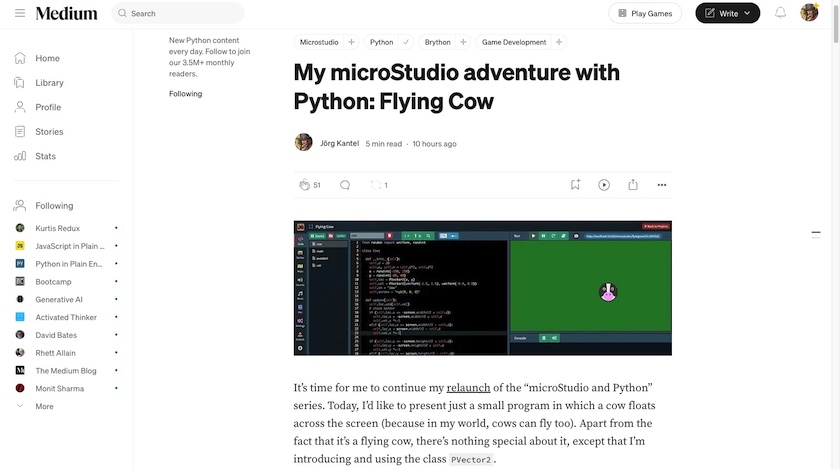

Nachdem ich auf meinen [ersten Versuch](https://kantel.github.io/posts/2026111902_english_medium_com/), einen mit Hilfe von Google Translate ins (d)englische übersetzten Beitrag auf Medium.com zu [veröffentlichen](https://medium.com/@joerg.kantel/microstudio-and-python-reloaded-7afee4d92179), etliche positive Reaktionen erhalten hatte, habe ich das Experiment nun wiederholt und auch den [zweiten Beitrag](https://kantel.github.io/posts/2026112501_flying_cow/) meines Relaunches der Reihe zu »microStudio und Python« durch Googles Übersetzer gejagt und nach einigen Nacharbeiten ebenfalls dort hochgeladen.

Hier ist also [**The Flying Cow with microStudio and Python**](https://medium.com/python-in-plain-english/my-microstudio-adventure-with-python-flying-cow-eee841993387) auf *Python in Plain English* (€).

Und jetzt singen alle (nach der Melodie von [Jambalaya](https://de.wikipedia.org/wiki/Jambalaya_(Hank-Williams-Lied))):

>In Peru, in Peru, in den Anden   
flog 'ne Kuh, flog 'ne Kuh, konnte nicht landen.   
denn in der Nacht, in der Nacht kamen Diebe.   
klauten der Kuh, klauten der Kuh das Getriebe.   
Sabotaaage!

In diesem Sinne: Lasst uns noch viele fliegenden Kühe bauen oder andere Verrücktheiten anstellen. *Still digging!*